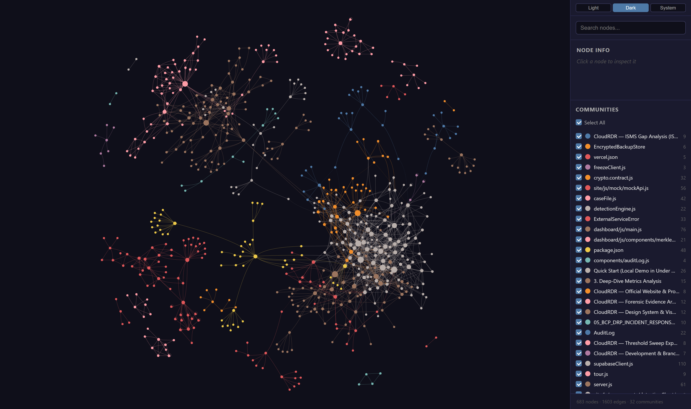
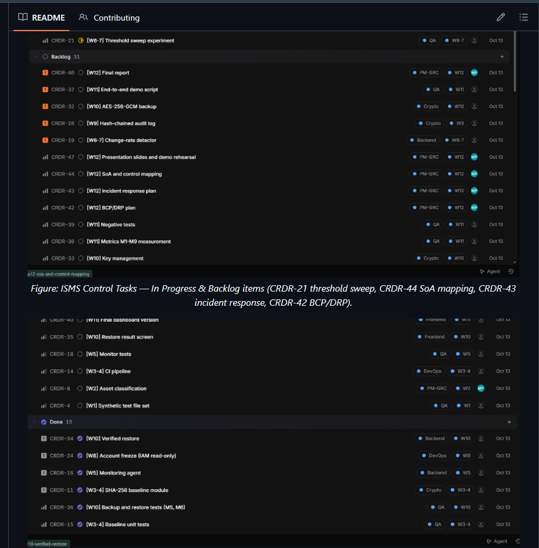
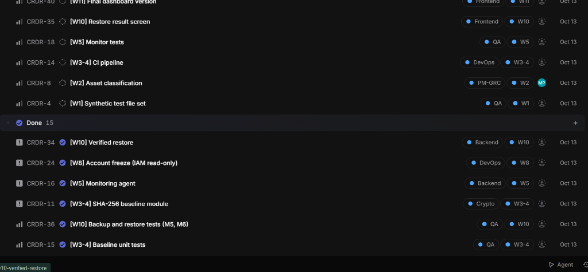

<div align="center">
  
  <p><strong>Cloud Ransomware Detection & Cryptographically Verified Recovery Platform</strong></p>
  <p>
    <a href="https://nodejs.org"></a>
    <a href="https://fastify.dev"></a>
    
    
    
    
  </p>
</div>

---

## Executive Overview

Modern cloud ransomware attacks rarely announce themselves with desktop ransom notes. Instead, attackers compromise cloud credentials, silently encrypt high-value objects inside storage buckets, and let automated backup pipelines sync encrypted ciphertext—poisoning recovery repositories before security analysts notice.

**CloudRDR** is an enterprise-grade cloud security operations platform designed to detect silent mass modifications, freeze compromised identities at the IAM control plane, preserve immutable cryptographic evidence, and guarantee verified recovery from clean backups.

### Core Guarantees:

1. **Mathematical Integrity Baseline**: Every protected object receives an immutable SHA-256 fingerprint folded pairwise into a deterministic Merkle tree root anchor.
2. **Real-Time Sliding-Window Detection**: Flags anomalous change velocity (e.g. >30% modifications within 30 seconds) and triggers immediate response if canary sentinel files are touched.
3. **Automated Safe Containment**: Restricts write privileges for compromised IAM credentials at the control plane while maintaining read access for forensic and recovery workflows.
4. **Cryptographic Evidence Preservation**: Generates RFC 8032 Ed25519-signed incident casefiles and records all administrative events in an immutable, tamper-evident hash-chained audit ledger.
5. **Zero-Trust Verified Recovery**: Decrypts AES-256-GCM backups into an isolated quarantine staging environment. Files are strictly verified against pre-attack baseline hashes (`VALID` / `MODIFIED` / `MISSING`) and require operator confirmation before live storage promotion.

---

## System Architecture

```
┌────────────────────────────────────────────────────────────────────────┐
│                        CloudRDR Platform Core                          │
│                                                                        │
│  ┌──────────┐    Change Events    ┌───────────────┐                    │
│  │  Monitor │────────────────────▶│   Detection   │                    │
│  │  Agent   │                     │    Engine     │                    │
│  └────┬─────┘                     └───────┬───────┘                    │
│       │                                   │ Ransomware Verdict         │
│       │ Poll Storage                      ▼                            │
│       ▼                           ┌───────────────┐                    │
│  ┌──────────┐                     │   Response    │──▶ Freeze IAM      │
│  │ Storage  │                     │    Service    │──▶ Ed25519 Sign    │
│  │ Adapter  │                     └───────┬───────┘──▶ Hash Audit Log  │
│  └────┬─────┘                             │                            │
│       │                                   ▼                            │
│       ▼                           ┌───────────────┐                    │
│  ┌──────────┐                     │   Verified    │◀── AES-256-GCM     │
│  │ Baseline │                     │    Restore    │──▶ Quarantine Stage│
│  │ Service  │                     └───────┬───────┘──▶ Promote Gate    │
│  └──────────┘                             │                            │
│                                           ▼                            │
│  ┌──────────────────────────────────────────────────────────────────┐  │
│  │                       HTTP REST & SOC API                        │  │
│  │  /status/system   /metrics/kpis   /incidents   /evidence/verify  │  │
│  └──────────────────────────────────────────────────────────────────┘  │
└───────────────────────────────────┬────────────────────────────────────┘
                                    │
           ┌────────────────────────┴────────────────────────┐
           ▼                                                 ▼
┌─────────────────────┐                           ┌─────────────────────┐
│  Public Showcase &  │                           │   SOC Operational   │
│   Landing Portal    │                           │   Admin Dashboard   │
│   (http://.../site) │                           │ (http://.../dashboard)│
└─────────────────────┘                           └─────────────────────┘
```

---

## Codebase Knowledge Graph & AST Architecture

CloudRDR maintains a continuous Abstract Syntax Tree (AST) knowledge graph mapping all 680+ structural symbols, modules, cryptographic boundaries, and operational controllers across 32 topological clusters.

<div align="center">
  
  <p><em>Interactive Graphify Knowledge Graph visualizing 683 nodes, 1,603 dependency edges, and 32 domain clusters across detection engine, cryptographic contracts, and SOC frontend.</em></p>
</div>

> **Interactive Architecture Inspection**: To interactively explore the complete architecture graph (pan, zoom, search, cluster filtering), open [`graphify-out/graph.html`](graphify-out/graph.html) directly in any web browser.

---

## ISMS (ISO/IEC 27001:2022) Governance & Task Tracking

The project operates under a formal **Information Security Management System (ISMS)** aligned with **ISO/IEC 27001:2022**, led by **Mübariz Paşayev (Project Manager & GRC Specialist)**. All security objectives, technological controls, incident response procedures, and testing gates are systematically tracked across work weeks (W1–W12) via a centralized project tracking board.

Complete ISMS Gap Analysis & Traceability: [`docs/grc/03_ISMS_GAP_ANALYSIS_ISO27001.md`](docs/grc/03_ISMS_GAP_ANALYSIS_ISO27001.md)

<div align="center">
  
  <p><em>Figure: ISMS Control Tasks — In Progress & Backlog items (CRDR-21 threshold sweep, CRDR-44 SoA mapping, CRDR-43 incident response, CRDR-42 BCP/DRP).</em></p>
</div>

<div align="center">
  
  <p><em>Figure: Completed ISMS Milestones — Verified restore (CRDR-34), IAM freeze containment (CRDR-24), monitoring agent (CRDR-16), baseline hashing (CRDR-11), and test harnesses (CRDR-36, CRDR-15).</em></p>
</div>

---

## Quick Start (Local Demo in Under 3 Minutes)

CloudRDR is preconfigured to run out of the box with zero external cloud dependencies using its built-in local filesystem adapter and in-memory persistence layer.

### 1. Prerequisites

- **Node.js**: ≥ 18.0.0
- **npm**: ≥ 9.0.0

### 2. Installation

```bash
git clone https://github.com/MbarizPaayev2/CloudRDR.git
cd CloudRDR
npm install
```

### 3. Environment Configuration

```bash
cp .env.example .env
# Default configuration uses local storage adapter and dev API keys
```

### 4. Seed Protected Files & Establish Cryptographic Baseline

```bash
npm run seed
# Creates sample protected documents and canary tripwire files under data/local-storage/protected
# Computes pairwise SHA-256 Merkle root anchor
```

### 5. Run the Automated End-to-End Attack Simulation

```bash
npm run simulate
# 1. Seeds clean baseline
# 2. Simulates attacker modifying 50% of protected files
# 3. Detection engine triggers ransomware alert
# 4. Response service freezes IAM credentials and creates Ed25519-signed manifest
# 5. Restores files to quarantine and verifies 100% pre-attack hash match
```

### 6. Start the API Server & SOC Admin Dashboard

```bash
npm start
# Server listens on http://localhost:3000
```

Open in your browser:

- **Public Interactive Site**: [http://localhost:3000/](http://localhost:3000/)
- **SOC Admin Dashboard**: [http://localhost:3000/dashboard](http://localhost:3000/dashboard)
- **Operator Login**: [http://localhost:3000/login](http://localhost:3000/login)
- **Account Registration**: [http://localhost:3000/register](http://localhost:3000/register)

### 7. Run Verification Test Suite

```bash
npm test
# Executes all 74 automated unit & integration tests across 23 test suites
```

---

## Core Security Capabilities

### 1. File Integrity Monitoring & Merkle Baselines

- Monitors protected object buckets, calculating 64-character SHA-256 content hashes.
- Builds pairwise Merkle DAGs (`src/crypto/ed25519.js`, `src/contracts/crypto.contract.js`).
- If even one bit of any protected file is altered, the Merkle root mismatch mathematically proves corruption.

### 2. Detection Engine & Sentinel Canaries

- Configurable sliding window (default 30 seconds, rate threshold 30%).
- Integrated canary tripwire monitoring (`tripwire_sentinel.docx`). Any modification or deletion of a canary triggers an immediate `critical` ransomware verdict regardless of change volume.
- Dynamic threshold adjustment via authenticated API (`POST /detection/config`).

### 3. Safe Control-Plane IAM Containment

- Safe isolation client with exponential backoff retry logic (`src/response/freezeClient.js`).
- Restricts write permissions for compromised identities while preserving read permissions for verification.
- Idempotent and auditable—every containment request generates an audit entry and updates incident records.

### 4. Authenticated Backup & Staged Quarantine Recovery

- Backup encryption using `AES-256-GCM` with random 96-bit initialization vectors and 128-bit AEAD authentication tags (`src/backup/backupService.js`).
- **Quarantine Staging**: Decrypted backup files are first extracted to an isolated directory (`data/quarantine/<jobId>/`).
- **Cryptographic Gate**: Each file is verified against pre-attack baseline SHA-256 fingerprints:
  - `VALID`: AEAD tag verified + restored SHA-256 exactly matches pre-attack baseline.
  - `MODIFIED`: AEAD failed or restored hash differs from baseline. Plaintext is suppressed.
  - `MISSING`: Backup archive does not contain the target file.
- **Operator Promotion**: Restored files are only written back to live storage after an authorized operator inspects the results and provides explicit confirmation (`POST /incidents/:id/promote`).

### 5. Tamper-Evident Audit Ledger

- Cryptographic hash-chained audit log (`src/log/auditLog.js`).
- Genesis block starts with `prevHash = 00...00`. Every event links to the preceding entry:
  $$\text{hash} = \text{SHA-256}(\text{index} \parallel \text{prevHash} \parallel \text{timestamp} \parallel \text{canonicalJson}(\text{data}))$$
- Complete chain verification utility (`verifyAuditChain`) detects any modified, deleted, or inserted historical records.

---

## HTTP REST API Reference

All protected endpoints require authentication via session cookie or `Authorization: Bearer <API_KEY>` / `x-api-key: <API_KEY>`.

### Platform Telemetry & SOC Monitoring

| Method | Endpoint                        | Description                                                                    |
| ------ | ------------------------------- | ------------------------------------------------------------------------------ |
| `GET`  | `/health`                       | System liveness, uptime, and memory status                                     |
| `GET`  | `/status/system`                | Live status across detection, storage, baseline, and backup services           |
| `GET`  | `/metrics/kpis`                 | Real-time counts: protected files, active incidents, 24h events, backup health |
| `GET`  | `/telemetry/activity?range=24H` | Bucketed time-series activity data (`1H`, `6H`, `24H`, `7D`)                   |
| `GET`  | `/events/recent`                | Unified chronological security event feed                                      |
| `GET`  | `/storage/overview`             | Storage backend health, object inventory, and WORM immutability state          |
| `GET`  | `/recovery/health`              | Cryptographic recovery health metrics (AEAD checks, baseline hash matches)     |

### Cryptographic Evidence & Audit Trail

| Method | Endpoint                   | Description                                                           |
| ------ | -------------------------- | --------------------------------------------------------------------- |
| `GET`  | `/integrity/cryptographic` | Real-time Merkle root verification & audit hash-chain integrity check |
| `POST` | `/evidence/verify`         | On-demand forensic validation of incident signatures and hash chains  |
| `GET`  | `/audit`                   | Query tamper-evident audit ledger with chain validity verification    |

### Baseline & Detection Engine

| Method | Endpoint             | Description                                                                          |
| ------ | -------------------- | ------------------------------------------------------------------------------------ |
| `POST` | `/baseline`          | Compute new baseline snapshot for a bucket (`{ "bucket": "protected" }`)             |
| `GET`  | `/baseline/:bucket`  | Retrieve latest Merkle root and cataloged file list                                  |
| `GET`  | `/detection/summary` | Current sliding-window velocity, observed rate, and tripwire status                  |
| `GET`  | `/detection/runs`    | Historical detection evaluations and verdicts (`normal`, `suspicious`, `ransomware`) |
| `POST` | `/detection/config`  | Update detection window, suspicious rate, and ransomware rate                        |

### Incident Lifecycle & Safe Recovery

| Method  | Endpoint                  | Description                                                                 |
| ------- | ------------------------- | --------------------------------------------------------------------------- |
| `GET`   | `/incidents`              | List security incidents (filter by `status`, `accountId`)                   |
| `GET`   | `/incidents/:id`          | Detailed incident record with Ed25519 signature and affected files          |
| `PATCH` | `/incidents/:id/status`   | Update incident status (`acknowledged`, `resolved`, `closed`)               |
| `POST`  | `/incidents/:id/contain`  | Execute safe control-plane write-freeze on compromised account              |
| `GET`   | `/incidents/:id/timeline` | Complete chronological timeline from alert to containment and recovery      |
| `POST`  | `/incidents/:id/restore`  | Stage decrypted backup files in quarantine and verify baseline hashes       |
| `POST`  | `/incidents/:id/promote`  | Promote verified quarantine files to live storage (`{ "confirmed": true }`) |
| `GET`   | `/restore/:jobId`         | Inspect file-level recovery outcomes (`VALID`, `MODIFIED`, `MISSING`)       |

### Identity & Authentication

| Method | Endpoint             | Description                                                     |
| ------ | -------------------- | --------------------------------------------------------------- |
| `POST` | `/api/auth/register` | Register new SOC operator account with secure password hashing  |
| `POST` | `/api/auth/login`    | Authenticate operator credentials and create persistent session |
| `GET`  | `/api/auth/me`       | Fetch authenticated operator profile                            |
| `POST` | `/api/auth/logout`   | Terminate active operator session                               |

---

## Quality & Verification Benchmarks

| Metric                       | Target        | Verified Value                        | Status   |
| ---------------------------- | ------------- | ------------------------------------- | -------- |
| **Unit & Integration Tests** | 100% Pass     | **74 / 74 Passing** (23 Suites)       | Verified |
| **ESLint Quality**           | 0 Errors      | **0 Errors, 0 Warnings**              | Verified |
| **Tamper Detection (M7)**    | Instant       | 100% Detected (Broken chain rejected) | Verified |
| **AEAD Authentication**      | Unconditional | 100% Corrupted blocks rejected        | Verified |
| **Baseline Accuracy (M9)**   | Deterministic | 100% Pre-attack SHA-256 match gate    | Verified |

---

## License

This project is developed for university research and educational demonstration in cloud security, cryptography, and incident recovery. Released under the **MIT License**.
