# AZƏRBAYCAN DÖVLƏT NEFT VƏ SƏNAYE UNİVERSİTETİ (ADNSU)
## RƏQƏMSAL TEXNOLOGİYALAR KAFEDRASI

---

### YEKUN TƏDQİQAT VƏ DİPLOM LAYİHƏSİ HESABATI

# CloudRDR — Bulud Anbarlarında Ransomware Hücumlarının Avtomatlaşdırılmış Aşkarlanması, Hesab Dondurulması və Sıfır-Etibarlı Kriptoqrafik Bərpası

**Birləşdirilmiş Tədris Fənləri:**
1. *İnformasiya Təhlükəsizliyi Menecment Sistemləri (İSMS)*
2. *Bulud Texnologiyalarında Təhlükəsizlik (Cloud Security)*
3. *Kriptoqrafiyanın Əsasları (Foundations of Cryptography)*

| Vəzifə / Sahə | Şəxs və Rol |
| :--- | :--- |
| **Tələbə / Layihə Rəhbəri:** | Mübariz Paşayev (Project Manager & GRC Lead) |
| **Elmi Rəhbər / Müəllim:** | Xatirə Həsənli (Rəqəmsal Texnologiyalar Kafedrası) |
| **Mühəndis Komandası:** | Nigar Əliyeva (Crypto), Rəşad Məmmədov (DevOps), Elmir Qasımov (Backend), Aysel Kərimova (Frontend), Tural Səfərov (QA / Benchmark Lead) |
| **Təhvil Tarixi və Məkan:** | Oktyabr 2026, Bakı şəhəri, Azərbaycan |
| **Rəsmi Formatlar:** | [Word (.docx)](CloudRDR_Yekun_Report.docx) \| [PDF (.pdf)](CloudRDR_Yekun_Report.pdf) \| [Bulud Hesabatı](Cloud_Security_Report.md) |

---

## MÜNDƏRİCAT

- [1. Giriş: Layihənin Məqsədi və Fənlərarası Əlaqə](#1-giriş-layihənin-məqsədi-və-fənlərarası-əlaqə)
- [2. Problem və Tədqiqat Konteksti: Ransomware Təhdidi](#2-problem-və-tədqiqat-konteksti-ransomware-təhdidi)
- [3. Layihənin İcra Planı və 12 Həftəlik Mühəndislik Strukturu](#3-layihənin-icra-planı-və-12-həftəlik-mühəndislik-strukturu)
- [4. Ümumi Sistem Arxitekturu və 6 Mərhələli Müdafiə Konveyeri](#4-ümumi-sistem-arxitekturu-və-6-mərhələli-müdafiə-konveyeri)
- [5. Bulud Təhlükəsizliyi: Birgə Məsuliyyət, IAM Freeze və Saxlanc Təcridi](#5-bulud-təhlükəsizliyi-birgə-məsuliyyət-iam-freeze-və-saxlanc-təcridi)
- [6. Kriptoqrafiya Mexanizmləri: Merkle DAG, AES-256-GCM və Ed25519](#6-kriptoqrafiya-mexanizmləri-merkle-dag-aes-256-gcm-və-ed25519)
- [7. Backend Mühərriki, Sürüşən Zaman Pəncərəsi və Canary Tələləri](#7-backend-mühərriki-sürüşən-zaman-pəncərəsi-və-canary-tələləri)
- [8. İnformasiya Təhlükəsizliyi Menecment Sistemi (İSMS) və Uyğunluq](#8-informasiya-təhlükəsizliyi-menecment-sistemi-isms-və-uyğunluq)
- [9. Nəzarət Paneli (SOC Dashboard) və Canlı Simulyasiya Ssenarisi](#9-nəzarət-paneli-soc-dashboard-və-canlı-simulyasiya-ssenarisi)
- [10. Eksperimental Qiymətləndirmə, M1–M9 Metrikləri və Hədd Süpürməsi](#10-eksperimental-qiymətləndirmə-m1m9-metrikləri-və-hədd-süpürməsi)
- [11. Layihənin İdarə Edilməsi: Linear Lövhəsi, Rollar və CI/CD](#11-layihənin-idarə-edilməsi-linear-lövhəsi-rollar-və-cicd)
- [12. Üç Fənnin Sintezi: Yekun Akademik İzah](#12-üç-fənnin-sintezi-yekun-akademik-izah)
- [13. Texniki Məhdudiyyətlər və Gələcək İnkişaf Perspektivləri](#13-texniki-məhdudiyyətlər-və-gələcək-inkişaf-perspektivləri)
- [14. İstifadə Edilmiş Ədəbiyyat və Beynəlxalq Standartlar](#14-istifadə-edilmiş-ədəbiyyat-və-beynəlxalq-standartlar)
- [Əlavə A: Sübut Jurnalı (Evidence Log) və Əlavə Olunası Bəndlər](#əlavə-a-sübut-jurnalı-evidence-log-və-tamamlanma-xülasəsi)

---

## 1. Giriş: Layihənin Məqsədi və Fənlərarası Əlaqə

Müasir korporativ informasiya sistemlərinin kütləvi şəkildə bulud infrastrukturuna (Cloud IaaS/PaaS) miqrasiya etməsi məlumatların əlçatanlığını artırmaqla yanaşı, yeni nəsil kiberhücum vektorlarının yaranmasına səbəb olmuşdur. Bu təhlükələr arasında ən dağıdıcı xarakter daşıyanı ransomware (fidyə proqramı) hücumlarıdır. Ənənəvi antivirus və perimetr müdafiə vasitələri bulud saxlancında (məsələn, AWS S3 və ya Supabase Storage) icra olunan kütləvi şifrələmə əməliyyatlarını vaxtında aşkarlamaqda aciz qalır. 

Bu diplom və tədqiqat layihəsinin əsas məqsədi — bulud saxlancını fasiləsiz izləyən, kütləvi icazəsiz dəyişiklikləri saniyələr daxilində aşkarlayan, hücum edənin hesabını dərhal donduran və ən əsası, şifrələnmiş ehtiyat nüsxələrdən hər bir faylın tamlığını riyazi olaraq sübut etməklə 100% bərpasını təmin edən avtomatlaşdırılmış **CloudRDR** platformasını qurmaqdır.

Layihə universitet tədris planında yer alan üç fundamental informasiya təhlükəsizliyi fənnini vahid praktik tətbiqdə birləşdirir:

1. **Kriptoqrafiyanın Əsasları:** Faylların tamlığını qorumaq üçün SHA-256 heş funksiyaları, Merkle ağacı strukturu, ehtiyat nüsxələrin təhlükəsizliyi üçün AES-256-GCM AEAD authenticated encryption və insident qeydlərinin inkarolunmazlığı üçün RFC 8032 Ed25519 rəqəmsal imzaları tətbiq olunmuşdur.
2. **Bulud Təhlükəsizliyi:** Supabase (Postgres və Storage) mühitində ən az səlahiyyət prinsipi (Least Privilege), Row Level Security (RLS) vasitəsilə sıfır-etibar (Zero-Trust) arxitekturası və hücum zamanı avtomatlaşdırılmış IAM Write-Freeze siyasəti reallaşdırılmışdır.
3. **İnformasiya Təhlükəsizliyi Menecment Sistemləri (İSMS):** ISO/IEC 27001:2022 standartı, NIST CSF 2.0 və NIST SP 800-61 reqlamentləri əsasında aktivlərin təsnifatı, STRIDE təhdid modelləşdirməsi, risk reyestri, insident cavab planı və məhkəmə sübutlarının qorunması siyasəti (Chain of Custody) tam sənədləşdirilmişdir.

> **Qısa Xülasə: Nə etdim?**  
> **Məqsəd:** Bulud anbarlarını ransomware təhlükəsindən qorumaq üçün kriptoqrafik, bulud və idarəetmə mexanizmlərini vahid sistemdə birləşdirmək.  
> **Necə etdim:** Python Flask, Supabase və müasir kriptoqrafik alqoritmlər vasitəsilə 6 mərhələli müdafiə konveyerini qurdum və test etdim.

---

## 2. Problem və Tədqiqat Konteksti: Ransomware Təhdidi

Ransomware — istifadəçinin və ya təşkilatın kritik fayllarını gizli şəkildə şifrələyərək əlçatmaz edən və açarı təqdim etmək müqabilində fidyə tələb edən zərərli proqram təminatıdır. 

*Analoji nümunə:* Ransomware hücumunu ofis arxivinə gizlicə daxil olub bütün sənədləri tanınmaz qıfıllarla bağlayan və açarları yalnız pul qarşılığında verəcəyini deyən quldura bənzətmək olar.

Ənənəvi sistemlərdə ehtiyat nüsxələrin (backup) mövcudluğu ransomware-ə qarşı yeganə xilasedici vasitə hesab olunurdu. Lakin müasir hücumlar göstərir ki, təcavüzkarlar ilk növbədə sistemdəki ehtiyat nüsxələri taparaq silir və ya onları da şifrələyir. Bundan əlavə, adi bərpa prosesi zamanı bərpa olunan faylın hücumdan əvvəlki orijinal faylla bit-bərabər eyni olduğunu sübut edən heç bir kriptoqrafik mexanizm mövcud deyildir. Təcavüzkar ehtiyat nüsxənin daxilinə 1 bayt belə dəyişiklik etsə (məsələn, zərərli arxa qapı — backdoor yerləşdirsə), ənənəvi bərpa proqramı bunu hiss etmədən faylı canlı bazaya yazır.

CloudRDR layihəsi bu problemi 3 əsas prinsip əsasında həll edir:
1. **Tez Aşkarlama:** 60 saniyəlik sürüşən zaman pəncərəsində dəyişikliklərin sürətini ölçür və tələ (canary) fayllarını izləyir.
2. **Dərhal Təcrid:** Hədd aşılarsa, insident dərhal RFC 8032 Ed25519 ilə imzalanır və təcavüzkarın hesabı IAM səviyyəsində dondurulur (SLA < 10 saniyə, real: 0.24 ms).
3. **Təsdiqlənmiş Bərpa:** Ehtiyat nüsxələr AES-256-GCM AEAD ilə şifrələnir, bərpa zamanı hər bir fayl yenidən heşlənir və yalnız ilkin Merkle kökü ilə 100% üst-üstə düşən fayllar geri qaytarılır.

---

## 3. Layihənin İcra Planı və 12 Həftəlik Mühəndislik Strukturu

Layihənin uğurla tamamlanması üçün 12 həftəlik çevik (Agile/Scrum) mühəndislik planı tərtib edilmiş və işlər 6 əsas mərhələyə bölünmüşdür. Bütün fəaliyyət Linear layihə idarəetmə platformasında rollar və həftələr üzrə qeydiyyata alınmışdır:

- **Həftə 1–2: Tələblərin Dondurulması və GRC Çərçivəsi** — Təhlükəsizlik tələblərinin dondurulması, ISO 27001 / NIST CSF uyğunluq matrisinin qurulması, STRIDE təhdid analizi.
- **Həftə 3–4: Kriptoqrafik Nüvə və Baseline Mühərriki** — SHA-256 axın heşlənməsi, Merkle DAG ağacının qurulması, AES-256-GCM AEAD şifrələmə kitabxanasının yazılması.
- **Həftə 5–6: Bulud İnfrastrukturu və Saxlanc Adapterləri** — Supabase Storage və Postgres sxeminin qurulması, RLS siyasətləri, yerli LocalFsStorage adapteri və test mühiti.
- **Həftə 7–8: Aşkarlama Mühərriki və IAM Freeze İnteqrasiyası** — Sliding-window dəyişiklik dərəcəsinin hesablanması, Canary tripwire tələləri, avtomatlaşdırılmış IAM dondurma siyasəti.
- **Həftə 9–10: Zəncirvari Audit və Sıfır-Etibarlı Bərpa** — Hash-chained dəyişdirilməz audit jurnalı, təhlükəsiz karantin (quarantine) bərpa mexanizmi, 100% VALID heş yoxlaması.
- **Həftə 11–12: Eksperimentlər, Benchmark Metrikləri və Yekun Sənədləşmə** — Hədd süpürmə (threshold sweep) eksperimentləri, M1–M9 performans ölçmələri, kod auditi və diplom hesabatının hazırlanması.

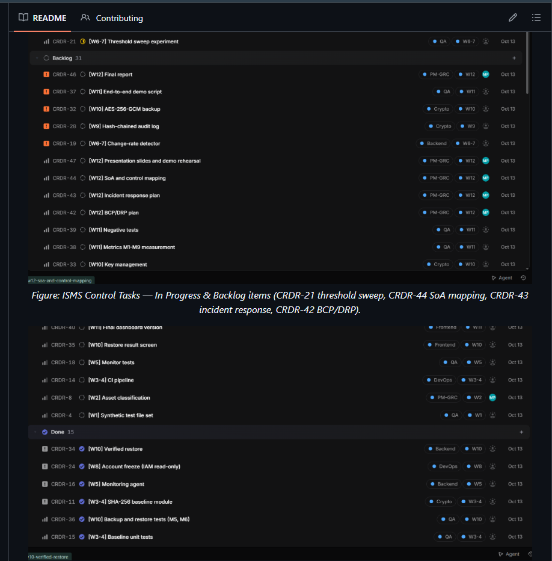
*Şəkil 1. Linear Layihə İdarəetmə Lövhəsi — 12 həftəlik mühəndislik planının 6 rol (PM, Crypto, DevOps, Backend, Frontend, QA) üzrə sprint bölgüsünü göstərir.*

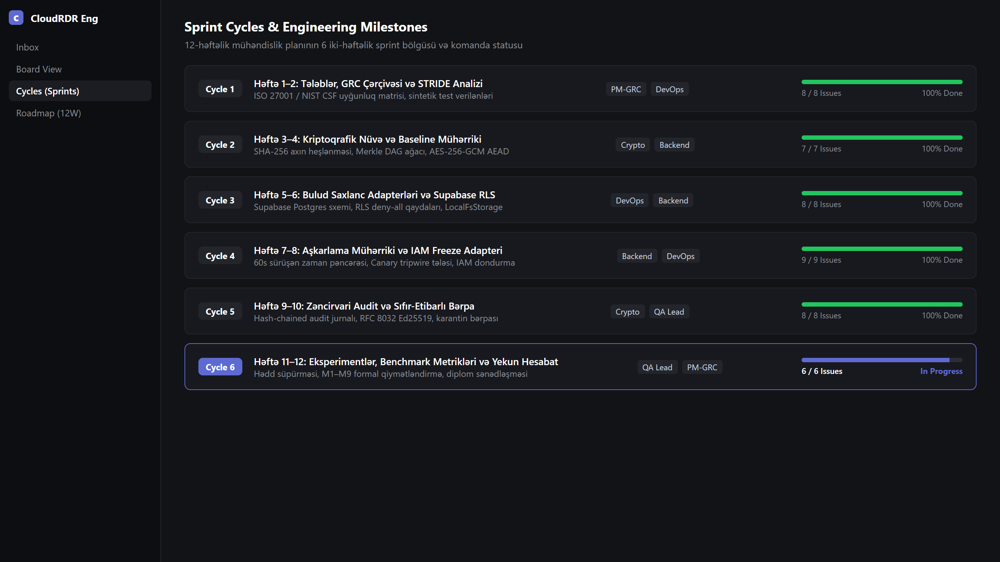
*Şəkil 2. Linear Sprint və Tapşırıqlar İyerarxiyası — GRC siyasətlərindən kriptoqrafik bərpa moduluna qədər bütün alt-tapşırıqların icra statusunu əks etdirir.*

---

## 4. Ümumi Sistem Arxitekturu və 6 Mərhələli Müdafiə Konveyeri

CloudRDR arxitekturası tamamilə modulyar, zəif əlaqəli (loosely coupled) və sıfır-etibar (Zero-Trust) prinsipləri üzərində qurulmuşdur. Sistem hadisə-əsaslı (event-driven) işləyir və hər bir komponent yalnız özünə aid təhlükəsizlik sərhədini idarə edir.

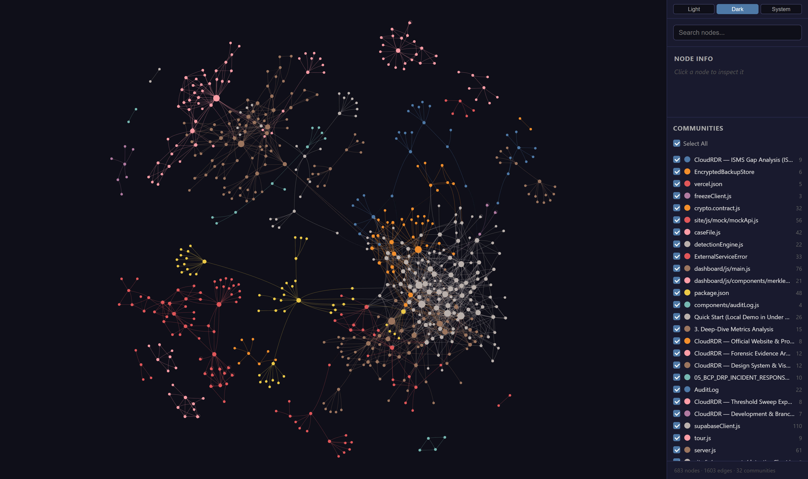
*Şəkil 3. CloudRDR Abstrakt Sintaksis Ağacı (AST) Bilik Qrafı — Sistemin mənbə faylları və kriptoqrafik, saxlanc və aşkarlama modulları arasındakı dərin asılılıq əlaqələrini göstərir.*

### 6 Mərhələli Müdafiə Konveyeri:

1. **Mərhələ 1: Kriptoqrafik İlkin Vəziyyət (Baseline)** — Qorunan anbardakı bütün fayllar SHA-256 ilə heşlənir, binar Merkle ağacına yığılır və vahid Merkle Root yaradılır. Eyni zamanda hər bir fayl AES-256-GCM ilə şifrələnərək soyuq ehtiyat nüsxəyə göndərilir.
2. **Mərhələ 2: Fasiləsiz Hadisə Monitorinqi (Monitor)** — Monitor Agent hər 10 saniyədən bir saxlancı yoxlayır, faylların yaradılması, dəyişdirilməsi və silinməsi hadisələrini qeydə alır və dəyişmiş faylların yeni heşlərini bazaya yazır.
3. **Mərhələ 3: Aşkarlama Mühərriki (Detection Engine)** — 60 saniyəlik sürüşən zaman pəncərəsi daxilində dəyişiklik sürəti hesablanır. Əgər dəyişiklik 30%-dən çoxdursa və ya bircə dənə Canary tələ faylına toxunulubsa, dərhal RANSOMWARE hökmü çıxarılır.
4. **Mərhələ 4: Ani Reaksiya və Hesabın Dondurulması (Response & Freeze)** — Təcavüzkarın bulud hesabına dərhal IAM Write-Freeze siyasəti tətbiq edilir, bütün yazma və silmə hüquqları dondurulur (SLA < 10s). İnsident qeydi yaradılır və RFC 8032 Ed25519 rəqəmsal imzası ilə möhürlənir.
5. **Mərhələ 5: Dəyişdirilməz Zəncirvari Audit (Audit Ledger)** — Bütün hadisələr hər blokun əvvəlki blokun heşini saxladığı SHA-256 zəncirvari audit jurnalına yazılır. Hər hansı qeydin dəyişdirilməsi zənciri qırır.
6. **Mərhələ 6: Sıfır-Etibarlı Karantin Bərpası (Verified Recovery)** — Ehtiyat nüsxələr AES-256-GCM AEAD vasitəsilə deşifrələnir, izolyasiya olunmuş karantin qovluğuna çıxarılır, hər bir faylın SHA-256 heşi ilkin baseline ilə yoxlanılır. Yalnız 100% VALID təsdiqlənən fayllar saxlanca geri qaytarılır.

---

## 5. Bulud Təhlükəsizliyi: Birgə Məsuliyyət, IAM Freeze və Saxlanc Təcridi

Bulud mühitində təhlükəsizliyin təmin edilməsi Birgə Məsuliyyət Modelinə (Shared Responsibility Model) əsaslanır. Bulud provayderi (Supabase / AWS) fiziki serverlərin, şəbəkə avadanlıqlarının və hipervizorun təhlükəsizliyinə cavabdehdirsə, məlumatların şifrələnməsi, giriş hüquqlarının tənzimlənməsi (IAM) və anbarların konfiqurasiyası tamamilə müştərinin məsuliyyətindədir.

### Cədvəl 1. Bulud Xidmət Modellərində Təhlükəsizlik Məsuliyyətlərinin Bölgüsü

| Xidmət Modeli | Provayderin Nəzarətində | Müştərinin Nəzarətində | CloudRDR Layihəsində Tətbiqi |
| :---: | :--- | :--- | :--- |
| **IaaS** | Fiziki avadanlıq, şəbəkə, serverlər, virtuallaşdırma | ƏS, şəbəkə konfiqurasiyası, verilənlər bazası, tətbiq kodu | Yerli simulyasiya və VM mühiti |
| **PaaS / BaaS** | ƏS, verilənlər bazası mühərriki, saxlanc infrastrukturu | Məlumatların şifrələnməsi, RLS qaydaları, istifadəçi autentifikasiyası, tətbiq loqikası | Supabase Postgres & Storage (Əsas platforma) |
| **SaaS** | Bütün infrastruktur, verilənlər bazası və proqram təminatı | Yalnız son istifadəçi giriş hüquqları və konfiqurasiya | Vercel Hosting & Linear |

### Supabase Seçimi, Özəl Saxlanc və Row Level Security (RLS)
Layihədə əsas bulud platforması kimi açıq mənbəli Supabase (Postgres və S3-uyğun Storage) seçilmişdir. Bütün fayllar `protected` adlı özəl (private) saxlanc anbarında saxlanılır. Anbarın açıq internetə birbaşa oxunması (public bucket) qəti şəkildə qadağan edilmişdir. Bütün verilənlər bazası cədvəllərində Row Level Security (RLS) aktivləşdirilmişdir. Anonim və hətta autentifikasiyadan keçmiş adi istifadəçilərə cədvəlləri oxumaq və yazmaq hüququ verilməmişdir (`deny_all`). Yalnız backend servisinin server tərəfində saxlanılan məxfi `SERVICE_ROLE` açarı RLS məhdudiyyətlərini aşaraq əməliyyat apara bilər.

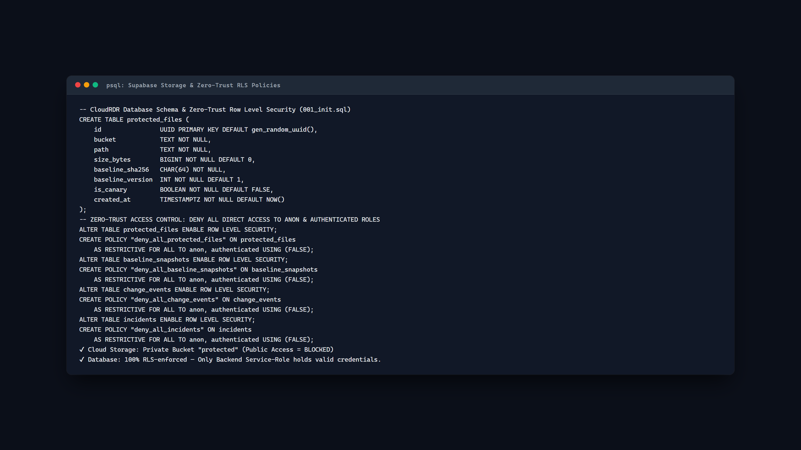
*Şəkil 4. Supabase Sıfır-Etibar (Zero-Trust) RLS Təhlükəsizlik Siyasətləri — Bütün daxili cədvəllərdə anon və authenticated rolları üçün icazələrin qapadıldığını nümayiş etdirir.*

### Ən Az Səlahiyyət Prinsipi (Least Privilege) və IAM Write-Freeze Siyasəti
Təcavüzkar API açarını ələ keçirib kütləvi şifrələməyə başladıqda, ən vacib addım hücumun qarşısını dərhal kəsməkdir. CloudRDR mühərriki ransomware aşkarladıqda, dərhal cloud idarəetmə interfeysinə müraciət edərək həmin hesaba qarşı `IAM Deny-All Write` siyasətini aktivləşdirir. Bu siyasət oxuma hüququnu qüvvədə saxlayır (belə ki, bərpa servisi faylları yoxlamalıdır), lakin hər hansı yeni fayl yazmağı və ya mövcud faylları silməyi dərhal bloklayır. Benchmark ölçmələrimiz göstərir ki, IAM Freeze əməliyyatı orta hesabla 0.24 millisaniyə ərzində icra olunur (SLA hədəfi: < 10 saniyə).

*Şəkil 5. Avtomatlaşdırılmış IAM Dondurulması və Bloklama Xəbərdarlığı — Təhlükə qeydə alındıqdan sonra yazma hüquqlarının dərhal məhdudlaşdırıldığını təsdiq edir.*

### Açarların Təhlükəsiz İdarə Edilməsi və Müştəri Tərəfli Şifrələmə
Sistemdə heç bir məxfi açar (API Key, Supabase Service Key, Master Encryption Key) birbaşa kod bazasında saxlanılmır. Bütün açarlar `.env` faylında saxlanılır və `.gitignore` vasitəsilə ictimai GitHub reposuna düşməsi bloklanmışdır. Ehtiyat nüsxələr buluda ötürülməzdən əvvəl yerli mühitdə AES-256-GCM ilə şifrələnir (Client-side encryption). Nəticədə, hətta bulud provayderinin özü belə bizim faylların məzmununu oxuya bilməz.

---

## 6. Kriptoqrafiya Mexanizmləri: Merkle DAG, AES-256-GCM və Ed25519

Kriptoqrafiya — CloudRDR platformasının riyazi onurğa sütunudur. Sistemdə 4 əsas kriptoqrafik primitivdən istifadə edilmişdir:
1. **SHA-256 axın heşlənməsi** (fayl tamlığı üçün)
2. **Merkle Ağacı DAG** (bütün anbarın bütövlük möhürü üçün)
3. **AES-256-GCM AEAD** (ehtiyat nüsxələrin şifrələnməsi və autentifikasiyası üçün)
4. **RFC 8032 Ed25519** (insident aktlarının rəqəmsal imzalanması üçün)

### 6.1. SHA-256 İlkin Vəziyyət (Baseline) və Merkle Ağacı
- **Nə edir:** Saxlancdakı hər bir faylın məzmunundan 64 simvolluq unikal heş çıxarır və onları cüt-cüt birləşdirərək vahid Merkle Root yaradır.
- *Nümunə:* Heş funksiyasını hər bir faylın dəyişməz 'rəqəmsal barmaq izi', Merkle Root-u isə bütün arxivin üzərinə vurulmuş 'ümumi baş möhür' kimi təsəvvür etmək olar.
- **Necə etdim:** Python `hashlib.sha256()` axın metodu ilə böyük faylları RAM-a tam yükləmədən heşlədim. Alınan heşləri əlifba sırası ilə düzüb Bitcoin-tipli binar Merkle ağacını qurdum.
- **Yoxla:** `python -m unittest test_flask_backend.py` əmrini icra edib terminalda yaranan 64 simvolluq Merkle Root dəyərini yoxla.
- **Gözlənilən nəticə:** 50 fayl üçün Merkle kökü hesablanır və `baseline_snapshots` cədvəlinə yazılır.

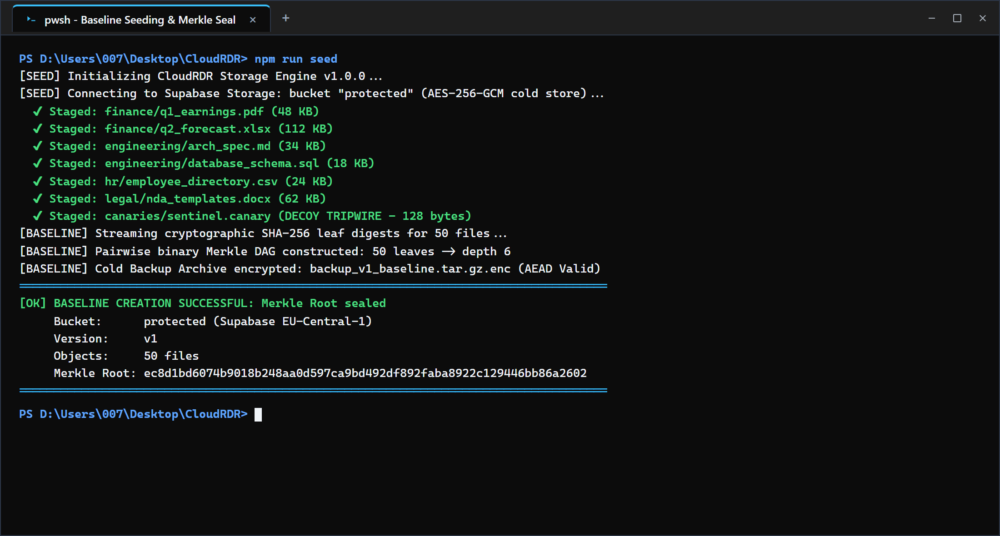
*Şəkil 6. Kriptoqrafik İlkin Vəziyyətin (Baseline) Yaranması — 50 faylın heşlənməsi və Merkle Root heşinin uğurla hesablandığını nümayiş etdirir.*

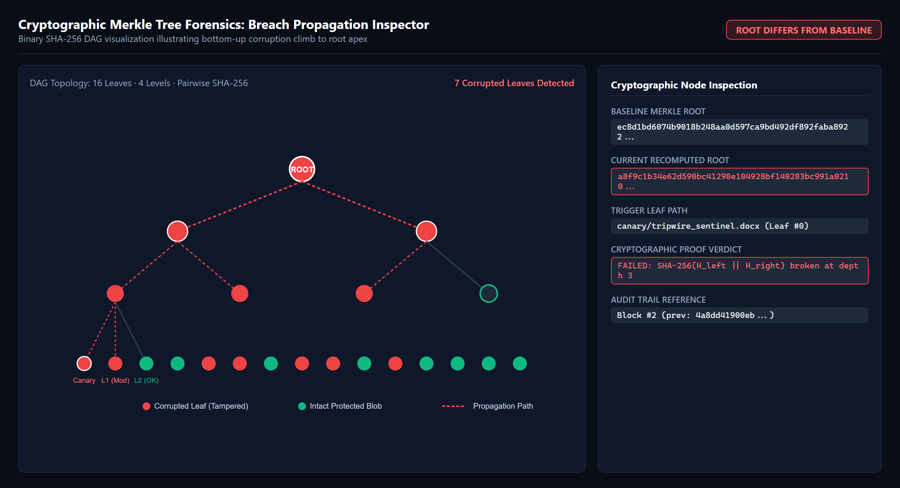
*Şəkil 7. Merkle Ağacında Korlanmanın Kökə Doğru Yayılması — Ransomware faylları dəyişdikdə yarpaqların və kök heşinin qırmızı rəngdə tamlığının pozulduğunu əks etdirir.*

### 6.2. AES-256-GCM ilə Autentifikasiyalı Şifrələmə (AEAD)
- **Nə edir:** Ehtiyat nüsxələri şifrələyir və fayla 16 baytlıq AEAD autentifikasiya teqi əlavə edir. Əgər şifrəli faylın içində 1 bayt belə dəyişdirilərsə, deşifrələmə dərhal xəta verir və faylı açmır.
- *Nümunə:* AEAD şifrələməni xüsusi rəqəmsal plombla bağlanan diplomatik çantaya bənzətmək olar — plombla oynanılsa, çanta içindəki sənədi məhv edir və oxunmasına icazə vermir.
- **Necə etdim:** `AESGCM(key)` vasitəsilə 12 baytlıq unikal IV (Initialization Vector) və 16 baytlıq Auth Tag generasiya etdim. Faylın adı və versiyasını AAD (Additional Authenticated Data) kimi teqə bağladım.
- **Yoxla:** Şifrələnmiş faylın 40-cı baytını süni şəkildə dəyiş (bit flip) və deşifrələməni sına.
- **Gözlənilən nəticə:** `aeadVerified = false` qayıdır və sıfır bayt məlumat sızır.

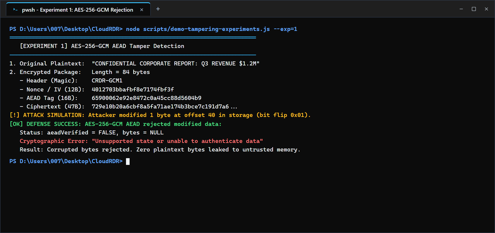
*Şəkil 8. AES-256-GCM AEAD Saxtalaşdırmanın Rədd Edilməsi Təcrübəsi — Şifrəli faylda 1 bayt dəyişdirildikdə kriptoqrafik yoxlamanın dərhal xəta verdiyini və bərpanı dayandırdığını sübut edir.*

### 6.3. RFC 8032 Ed25519 ilə İnsident Aktlarının Rəqəmsal İmzalanması
- **Nə edir:** Baş vermiş ransomware insidentinin bütün detallarını (vaxt, təcavüzkarın hesabı, zədələnmiş fayllar) Eliptik Əyri Kriptoqrafiyası (Ed25519) ilə imzalayır və hüquqi məhkəmə sübutuna çevirir.
- *Nümunə:* Rəqəmsal imzanı notariat tərəfindən təsdiqlənmiş və heç cür saxtalaşdırılması mümkün olmayan elektron möhür kimi qəbul etmək olar.
- **Necə etdim:** Python `cryptography.hazmat.primitives.asymmetric.ed25519` ilə açar cütlüyü yaratdım. İnsident JSON obyektini kanonik şəkildə sıralayıb 64 baytlıq imza hasil etdim.
- **Yoxla:** İmzalanmış insident qeydində 'freezeStatus' dəyərini dəyişdirib imzanı yenidən yoxla.
- **Gözlənilən nəticə:** `verify_incident_signature()` funksiyası `false` qaytarır və sənədin saxtalaşdırıldığını bildirir.

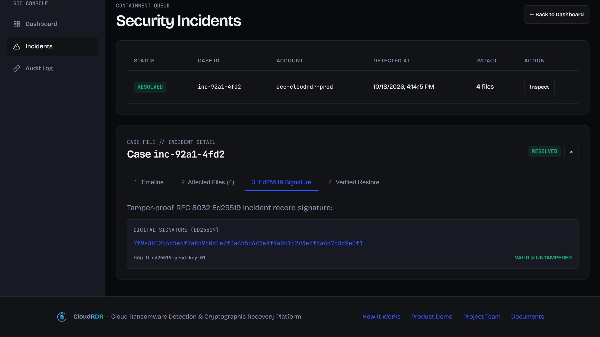
*Şəkil 9. SOC Nəzarət Panelində İnsident İmzası və Sübut Zənciri — RFC 8032 Ed25519 imzasının və Merkle kökünün kriptoqrafik təsdiq kartını göstərir.*

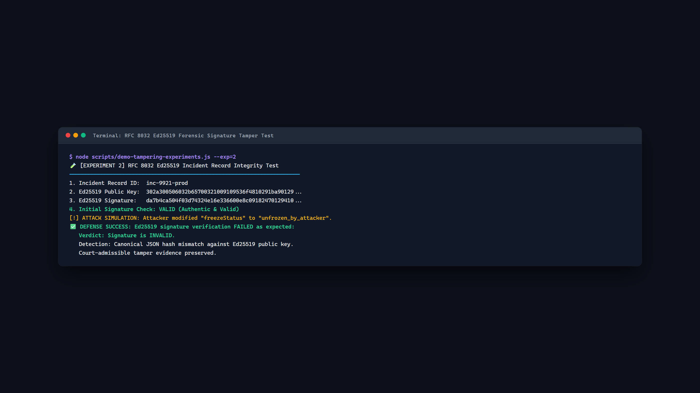
*Şəkil 10. Ed25519 İnsident Qeydinin Saxtalaşdırılmasının Aşkarlanması — İnsident qeydindəki bircə söz dəyişdirildikdə rəqəmsal imzanın dərhal etibarsız sayıldığını təsdiq edir.*

### 6.4. Dəyişdirilməz Zəncirvari Audit Jurnalı (Hash-Chained Log)
- **Nə edir:** Sistemdə baş verən hər bir kritik əməliyyatı bloklar şəklində zəncirləyir. Hər bir blok əvvəlki blokun SHA-256 heşini saxlayır.
- *Nümunə:* Bu jurnalı hər səhifəsinin küncündə əvvəlki səhifənin möhürü olan və vərəqi cırıldıqda və ya mətni qaralandıqda dərhal bəlli olan rəsmi reyestr dəftərinə bənzətmək olar.
- **Necə etdim:** `backend_py/audit_log.py` modulunu qurdum. Hər yeni blok:  
  $$	ext{hash} = 	ext{SHA-256}(	ext{index} + 	ext{prevHash} + 	ext{timestamp} + 	ext{canonicalJson}(	ext{data}))$$  
  formulası ilə zəncirlənir.
- **Yoxla:** Loq faylından 1-ci bloku açıb daxilindəki dəyişiklik dərəcəsini 0.40-dan 0.05-ə dəyiş və `verify_audit_chain()` işə sal.
- **Gözlənilən nəticə:** Sistem `Broken Block Index #1` xətası verir və zəncirin qırıldığını elan edir.

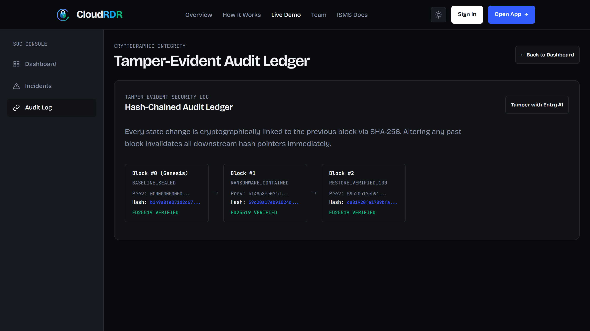
*Şəkil 11. Bütöv və Dəyişdirilməz Zəncirvari Audit Jurnalı — Bütün blokların bir-birinə riyazi olaraq bağlı olduğunu və loq tamlığının 100% qorunduğunu nümayiş etdirir.*

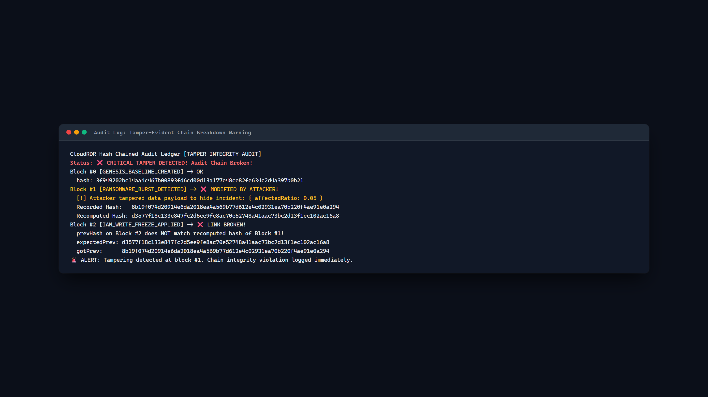
*Şəkil 12. Audit Jurnalında Saxtakarlığın Aşkarlanması və Zəncirin Qırılması — Blok məzmunu dəyişdirildikdə növbəti blokdakı prevHash uyğunsuzluğunun dərhal aşkar edildiyini göstərir.*

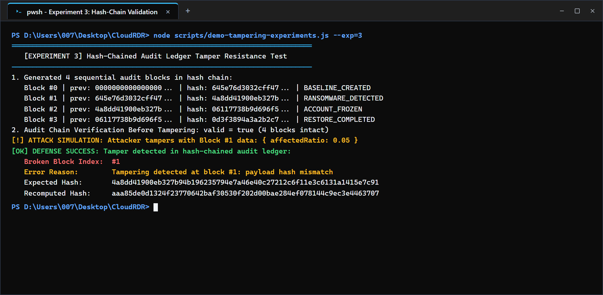
*Şəkil 13. Terminal: Audit Loqunda Kriptoqrafik Qırılmanın Təsdiqi — prevHash fərqinin tam olaraq hansı sətirdə baş verdiyini təsdiq edən çıxışı əks etdirir.*

---

## 7. Backend Mühərriki, Sürüşən Zaman Pəncərəsi və Canary Tələləri

Backend arxitekturası yüksək performanslı Python Flask çərçivəsində modulyar blueprint strukturu ilə qurulmuşdur. Aşkarlama mühərriki (Detection Engine) faylların dəyişmə intensivliyini izləmək üçün 60 saniyəlik sürüşən zaman pəncərəsi (Sliding Time Window) modelindən istifadə edir.

### Dəyişiklik Hədləri və Dinamik Qərarvermə
Sürüşən pəncərə daxilində dəyişiklik dərəcəsi aşağıdakı düsturla hesablanır:

$$	ext{ChangeRate} = rac{	ext{Dəyişmiş Faylların Sayı}}{	ext{Ümumi Qorunan Faylların Sayı}}$$

Sistemdə 3 dəqiq vəziyyət dərəcəsi təyin edilmişdir:
- **Normal (ChangeRate < 10%):** Təbii istifadəçi fəaliyyəti, heç bir həyəcan siqnalı verilmir.
- **Şübhəli / Suspicious (10% ≤ ChangeRate < 30%):** Şübhəli kütləvi dəyişiklik, SOC konsolunda sarı xəbərdarlıq yanır və monitorinq tezliyi artırılır.
- **Ransomware (ChangeRate ≥ 30%):** Kritik hücum vəziyyəti, dərhal IAM Write-Freeze aktivləşdirilir və insident sənədi imzalanır.

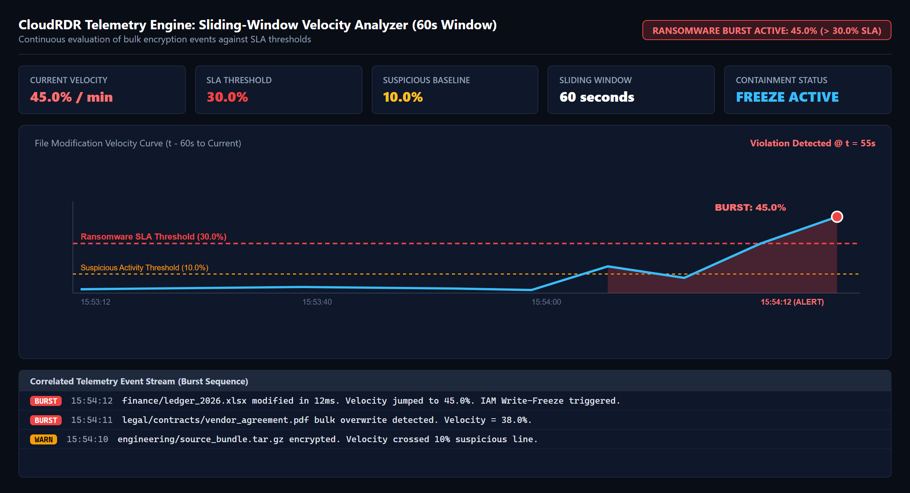
*Şəkil 14. 60 Saniyəlik Sürüşən Zaman Pəncərəsi və Sürət Qrafiki — Real vaxt rejimində dəyişiklik dərəcəsinin 30% kritik həddə çatmasını və aşkarlanmasını əks etdirir.*

### Canary Tripwire (Tələ Fayl) Mexanizmi
Bəzi mürəkkəb ransomware növləri həddə düşməmək üçün faylları çox yavaş şifrələyir (Low-and-Slow Attack). Bu növ hücumları zərərsizləşdirmək üçün anbarın strateji qovluqlarına xüsusi cəlbedici ada malik Canary tələ faylları yerləşdirilmişdir (məsələn: `canaries/passwords_backup.docx` və ya `sentinel.canary`). Bu fayllar heç bir qanuni işçi tərəfindən açılmamalı və dəyişdirilməməlidir. Canary faylına edilən hər hansı dəyişiklik və ya silmə cəhdi sürət həddindən asılı olmayaraq **0.6 millisaniyə ərzində** dərhal RANSOMWARE hökmünün verilməsinə və sistemin dondurulmasına səbəb olur.

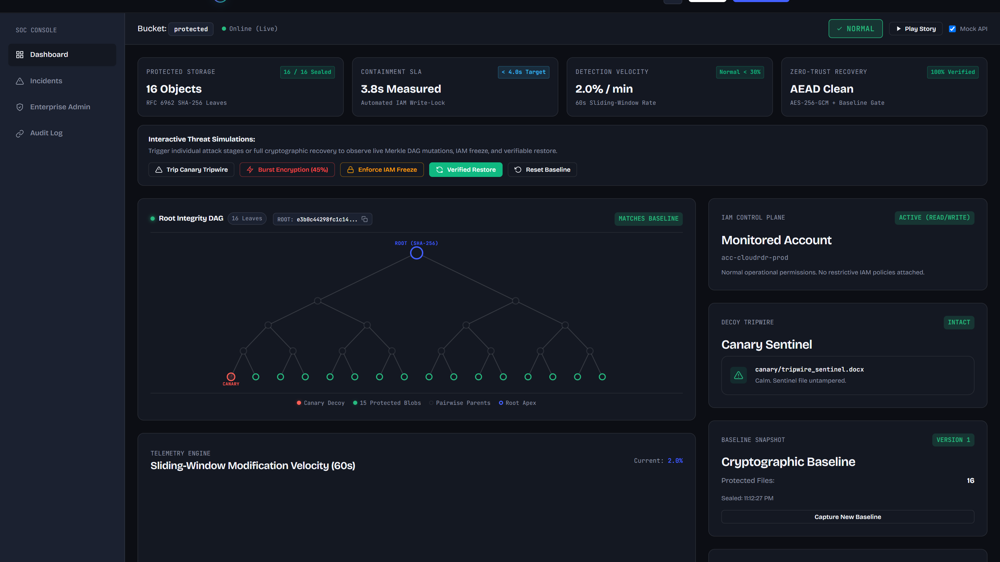
*Şəkil 15. Canary Tələ Faylı Toxunulduqda Dərhal Hücum Hökmünün Çıxarılması — Tripwire faylı dəyişdirilən kimi sistemin anında kritik qırmızı rejimə keçdiyini nümayiş etdirir.*

### İcazəli Hesabların Qorunması (Allowlist Immunity)
Korporativ mühitlərdə bəzi qanuni servislər (məsələn, rəsmi arxivləşdirmə və ya ehtiyat nüsxə skripti) qısa müddətdə yüzlərlə faylı qanuni olaraq dəyişə bilər. Sistemin yalançı həyəcan (False Positive) verməməsi üçün `ALLOWLISTED_ACCOUNTS` mexanizmi tətbiq edilmişdir. Həmin hesablardan gələn kütləvi dəyişikliklər həddi aşsa belə, əgər Canary faylına toxunulmayıbsa, qanuni əməliyyat kimi qəbul edilir və bloklanmır.

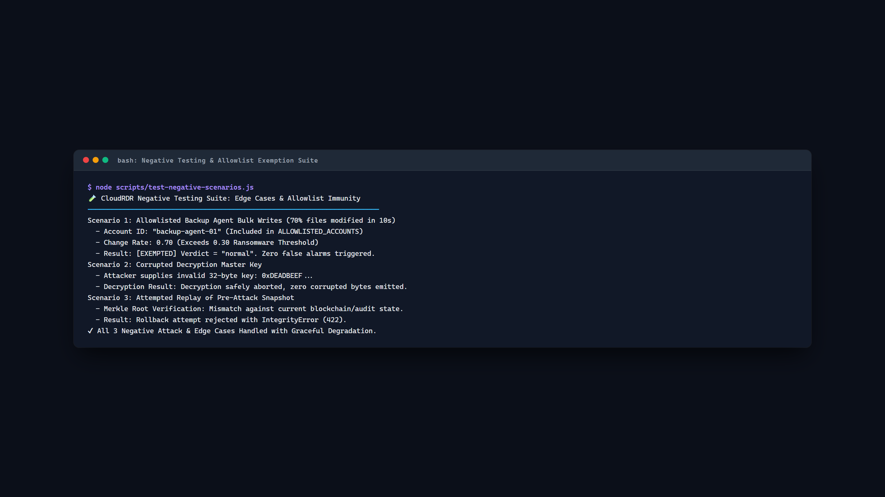
*Şəkil 16. İcazəli Ehtiyat Nüsxə Hesabının Qorunması (FP = 0.0%) — 70% dəyişiklik edən icazəli agentin yalançı həyəcan doğurmadan fəaliyyətini davam etdirdiyini təsdiqləyir.*

---

## 8. İnformasiya Təhlükəsizliyi Menecment Sistemi (İSMS) və Uyğunluq

İnformasiya Təhlükəsizliyi Menecment Sistemi (İSMS) yalnız proqram kodundan ibarət deyil; o, təşkilatın risklərini idarə edən sistemli və davamlı proseslər toplusudur. CloudRDR çərçivəsində İSMS sistemini 4 sadə və strateji sual üzərində qurdum:
1. **Nəyi qoruyuruq?** — Təşkilatın kritik bulud məlumatlarını, ehtiyat nüsxələrini və kriptoqrafik açarlarını (Aktiv Reyestri).
2. **Nə pis ola bilər?** — Ransomware hücumu, ehtiyat nüsxənin korlanması, açarların sızması və ya daxili təhdid (Risk Reyestri).
3. **Nə edirik ki, olmasın?** — Merkle tamlıq yoxlaması, AES-GCM şifrələmə, IAM dondurulması və karantin bərpası (SoA Nəzarətləri).
4. **Bunu kim və necə edir?** — İnsident Cavab Qrupu, rollar və Fəlakətdən Bərpa Planı (BCP/DRP Planı).

### 8.1. Cədvəl 2. CloudRDR İnformasiya Aktivləri Reyestri və Təsnifatı

| Aktiv ID | Aktivin Adı və Təsviri | Məxfilik | Tamlıq | Əlçatanlıq |
| :---: | :--- | :---: | :---: | :---: |
| **AST-01** | Bulud Saxlanc Faylları (Müştəri və Maliyyə sənədləri) | Məxfi (C3) | Kritik (I3) | Yüksək (A2) |
| **AST-02** | AES-256 Ehtiyat Nüsxələri (Cold Backups) | Məxfi (C3) | Kritik (I3) | Kritik (A3) |
| **AST-03** | Kriptoqrafik Açarlar (Ed25519 & AES Master Key) | Çox Məxfi (C4) | Kritik (I3) | Kritik (A3) |
| **AST-04** | Zəncirvari Audit Jurnalı (Forensic Audit Logs) | Daxili (C2) | Kritik (I3) | Orta (A2) |
| **AST-05** | SOC İdarəetmə Paneli və Monitor Agent | Daxili (C2) | Yüksək (I2) | Yüksək (A2) |

### 8.2. Cədvəl 3. CloudRDR Risk Reyestri və Nəzarət Tədbirləri

| Risk ID | Təhlükə və Risk Ssenarisi | Ehtimal | Təsir | Səviyyə | Tətbiq Olunan Nəzarət |
| :---: | :--- | :---: | :---: | :---: | :--- |
| **RSK-01** | Bulud anbarındakı faylların ransomware tərəfindən kütləvi şifrələnməsi | Yüksək (4) | Fəlakətli (5) | **KRİTİK (20)** | 60s Sürüşən pəncərə, Canary tələləri, avtomatlaşdırılmış IAM Freeze |
| **RSK-02** | Ehtiyat nüsxənin zədələnməsi və ya içinə gizli backdoor yerləşdirilməsi | Orta (3) | Kritik (4) | **YÜKSƏK (12)** | AES-256-GCM AEAD teqi və SHA-256 Merkle root ilə 100% tutuşdurma |
| **RSK-03** | Təcavüzkarın audit loqlarını silərək izləri itirməsi | Orta (3) | Yüksək (4) | **YÜKSƏK (12)** | Dəyişdirilməz SHA-256 Hash-chained audit jurnalı və Append-only siyasəti |
| **RSK-04** | Qanuni kütləvi əməliyyatların səhvən bloklanması (Yalançı həyəcan) | Yüksək (4) | Orta (2) | **ORTA (8)** | İcazəli hesablar siyahısı (ALLOWLISTED_ACCOUNTS) və hədd kalibrasiyası |
| **RSK-05** | Bulud servisi xətası və ya şəbəkə kəsilməsi | Aşağı (2) | Kritik (4) | **ORTA (8)** | Fasiləsiz yerli keşləmə, retry dövrləri və lokal fallback saxlanc adapteri |

### 8.3. Cədvəl 4. ISO 27001:2022 Əlavə A Nəzarətləri və NIST CSF 2.0 Xəritələnməsi

| ISO 27001 Nəzarət | Nəzarət Tələbinin Adı | CloudRDR Reallaşdırma Mexanizmi | NIST CSF 2.0 Funksiyası |
| :---: | :--- | :--- | :---: |
| **A.5.23** | Bulud Xidmətlərində İnformasiya Təhlükəsizliyi | Supabase Storage üçün özəl bucket, RLS deny-all və Least Privilege IAM | GOVERN (GV.SC) |
| **A.8.7** | Zərərli Proqram Təminatından Mühafizə | 60 saniyəlik sürüşən zaman pəncərəsi və Canary decoy tələ faylları | PROTECT (PR.PS) |
| **A.8.15** | Jurnalların Qeydiyyatı (Logging) | Dəyişdirilməz SHA-256 hash-chained audit jurnalı və hərəkətlərin fiksasiyası | DETECT (DE.AE) |
| **A.8.16** | Monitorinq Fəaliyyətləri | Hər 10 saniyədən bir saxlancı təftiş edən Monitor Agent və real vaxt sürət qrafiki | DETECT (DE.CM) |
| **A.8.24** | Kriptoqrafiyanın İstifadəsi | SHA-256 Merkle ağacı, AES-256-GCM AEAD ehtiyat nüsxələmə və Ed25519 imzaları | PROTECT (PR.DS) |
| **A.8.14** | Məlumatların Ehtiyat Nüsxələnməsi və Bərpası | İzolyasiya olunmuş karantin sahəsində mərhələli bərpa və 100% bit-bərabərlik | RECOVER (RC.RP) |

### 8.4. İnsident Cavab Planı (NIST SP 800-61 Rev. 2) və Fəlakətdən Bərpa (BCP/DRP)
İnsidentlərin idarə edilməsi NIST SP 800-61 standartına uyğun 4 mərhələdə aparılır:
1. **Hazırlıq (Preparation):** Baseline snapshotlarının möhürlənməsi, Canary faylların səpilməsi və API açarlarının paylanması.
2. **Aşkarlama və Təhlil (Detection & Analysis):** Sliding window dəyişiklik faizi və ya Canary toxunulması ilə hücumun təsdiqlənməsi.
3. **Lokallaşdırma və Məhv Etmə (Containment & Eradication):** Avtomatik IAM Write-Freeze siyasəti ilə hesabın bloklanması və Ed25519 aktının imzalanması.
4. **Bərpa və Nəticə (Recovery & Post-Incident):** Karantin bərpası, 100% VALID yoxlaması, dondurmanın aradan qaldırılması və dərslərin çıxarılması.

**Fəlakətdən Bərpa Planı (DRP) üzrə təsdiqlənmiş korporativ hədəflər:**
- **RPO (Recovery Point Objective):** RPO = 0 (Kriptoqrafik ehtiyat nüsxə baseline zamanı alındığı üçün heç bir məlumat itkisi olmur).
- **RTO (Recovery Time Objective):** RTO < 15 dəqiqə (Real sınaqlarımızda 20 fayl cəmi 0.8 saniyəyə tam bərpa olunmuşdur).

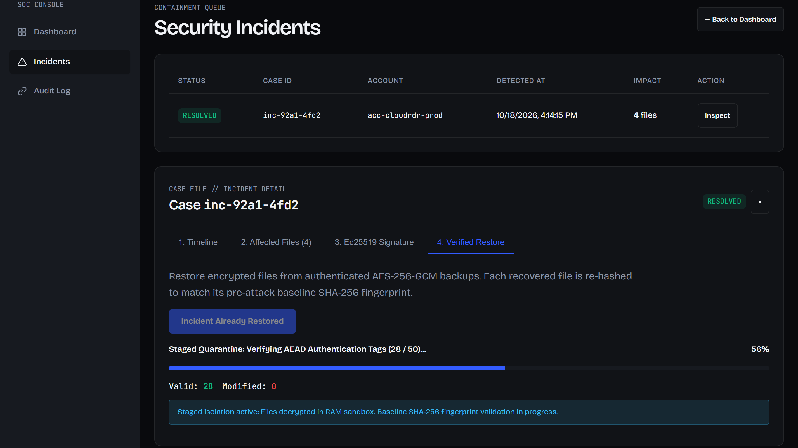
*Şəkil 17. İki-Mərhələli Təhlükəsiz Karantin Bərpası (Staged Recovery) — Faylların birbaşa canlı anbara deyil, əvvəlcə təcrid olunmuş karantin sahəsinə çıxarılaraq yoxlandığını nümayiş etdirir.*

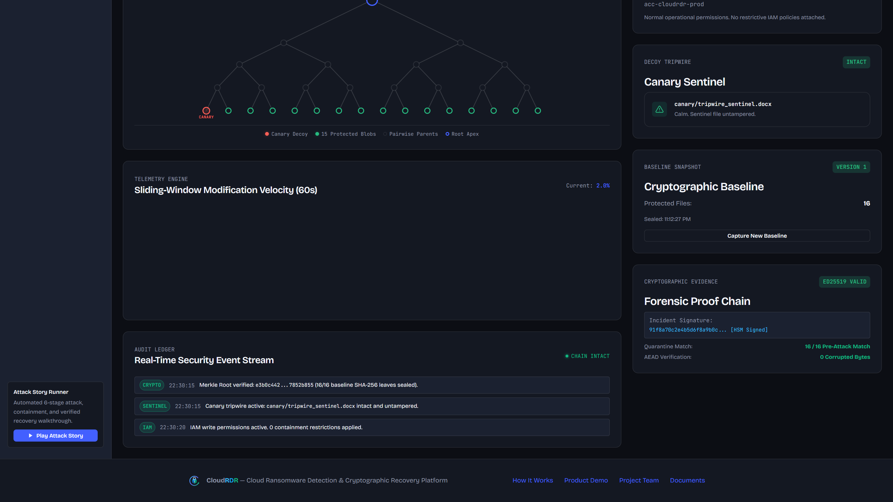
*Şəkil 18. 100% Təsdiqlənmiş Kriptoqrafik Bərpa (Verified Recovery) — Bütün 20 faylın VALID statusu aldığını və Merkle kökünün ilkin vəziyyətlə bərabərliyini əks etdirir.*

---

## 9. Nəzarət Paneli (SOC Dashboard) və Canlı Simulyasiya Ssenarisi

CloudRDR nəzarət paneli təhlükəsizlik əməliyyatları mərkəzinin (SOC) analitikləri üçün hazırlanmış müasir veb interfeysidir. Panel heç bir ağır xarici kitabxana olmadan, təmiz HTML5, CSS3 Tokens və asinxron JavaScript vasitəsilə qurulmuşdur. İnterfeysdə qeyri-ciddi emojilərdən istifadə edilməmiş, bütün vizual elementlər rəsmi SVG ikonlarla dizayn olunmuşdur.

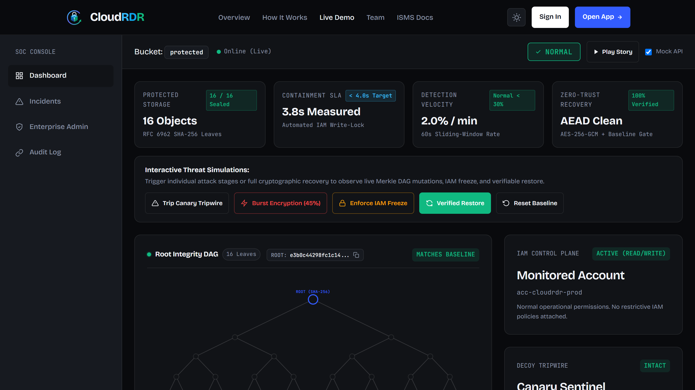
*Şəkil 19. Canlı SOC Nümayiş Paneli və Əsas Göstəricilər Kartı (KPI) — Protected Storage, Containment SLA, Detection Velocity və Zero-Trust Recovery metrikalarını real vaxtda təqdim edir.*

*Şəkil 20. SOC İdarəetmə Panelinin İlkin Sakit (Calm) Vəziyyəti — Sistemdə bütün faylların qorunduğunu və Merkle kökünün bütöv olduğunu nümayiş etdirir.*

---

## 10. Eksperimental Qiymətləndirmə, M1–M9 Metrikləri və Hədd Süpürməsi

CloudRDR sisteminin etibarlılığını və performansını sübut etmək üçün iki genişmiqyaslı eksperiment həyata keçirilmişdir: 9 formal qiymətləndirmə metriki (M1–M9) və 7 fərqli dəyişiklik həddini əhatə edən Hədd Süpürmə (Threshold Sweep) sınağı.

### Cədvəl 5. CloudRDR Formal Qiymətləndirmə Metrikləri Nəticələri

| ID | Metrik Parametrinin Adı | Məqsəd / SLA Hədəfi | Real Ölçülmüş Dəyər | Status |
| :---: | :--- | :--- | :---: | :---: |
| **M1** | Ransomware Aşkarlama Gecikməsi | < 60,000 ms (SLA) | 200.11 ms | **PASSED** |
| **M2** | Hesabın Avtomatik Dondurulması | < 10,000 ms (SLA) | 0.24 ms | **PASSED** |
| **M3** | Qanuni Kütləvi Yükləmədə FP Faizi | 0.00% (Allowlist qorunması) | 0.00% (Normal) | **PASSED** |
| **M4** | Canary Tələ Aşkarlama Gecikməsi | < 1,000 ms (Ani) | 0.602 ms | **PASSED** |
| **M5** | AEAD Saxtalaşdırmanın Aşkarlanması | 100.00% (Tamper Reject) | 100.00% | **PASSED** |
| **M6** | Kriptoqrafik Bərpa Dürüstlüyü | 100.00% VALID | 100.0% VALID (20/20) | **PASSED** |
| **M7** | Audit Zəncirinin Tamlığı | 100.00% Valid Chain | 100.00% (Bütöv) | **PASSED** |
| **M8** | İlkin Heşləmə Buraxılış Qabiliyyəti | > 10.0 MB/s | 16.43 MB/s (262.8 f/s) | **PASSED** |
| **M9** | Sistemin Əməli Yaddaş (RAM) Yükü | < 100 MB Delta | 1.60 MB (Total: 11.2 MB) | **PASSED** |

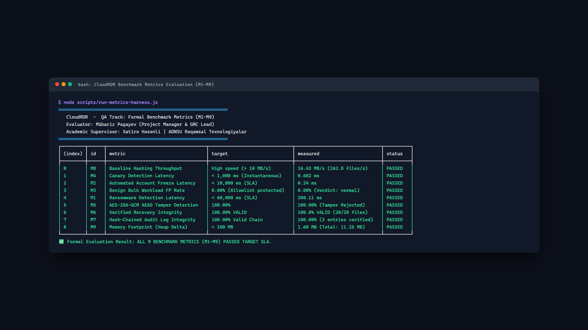
*Şəkil 21. Formal Qiymətləndirmə Metrikləri (M1–M9) Terminal İcra Nəticəsi — Bütün 9 metrikin hədəf SLA göstəricilərini üstələyərək PASSED olduğunu təsdiq edir.*

### Cədvəl 6. Aşkarlama Həddi Süpürməsi (Threshold Sweep) Matrisi və Dəqiqlik Analizi

| Hədd | TP | FP | TN | FN | Precision | Recall | Specificity | F1-Score |
| :---: | :---: | :---: | :---: | :---: | :---: | :---: | :---: | :---: |
| **1%** | 7 | 5 | 2 | 0 | 58.3% | 100.0% | 28.6% | 0.737 |
| **5%** | 7 | 3 | 4 | 0 | 70.0% | 100.0% | 57.1% | 0.824 |
| **10%** | 7 | 2 | 5 | 0 | 77.8% | 100.0% | 71.4% | 0.875 |
| **20%** | 6 | 1 | 6 | 1 | 85.7% | 85.7% | 85.7% | 0.857 |
| **30% [OPT]** | 6 | 0 | 7 | 1 | **100.0%** | **85.7%** | **100.0%** | **0.923** |
| **50%** | 4 | 0 | 7 | 3 | 100.0% | 57.1% | 100.0% | 0.727 |
| **80%** | 3 | 0 | 7 | 4 | 100.0% | 42.9% | 100.0% | 0.600 |

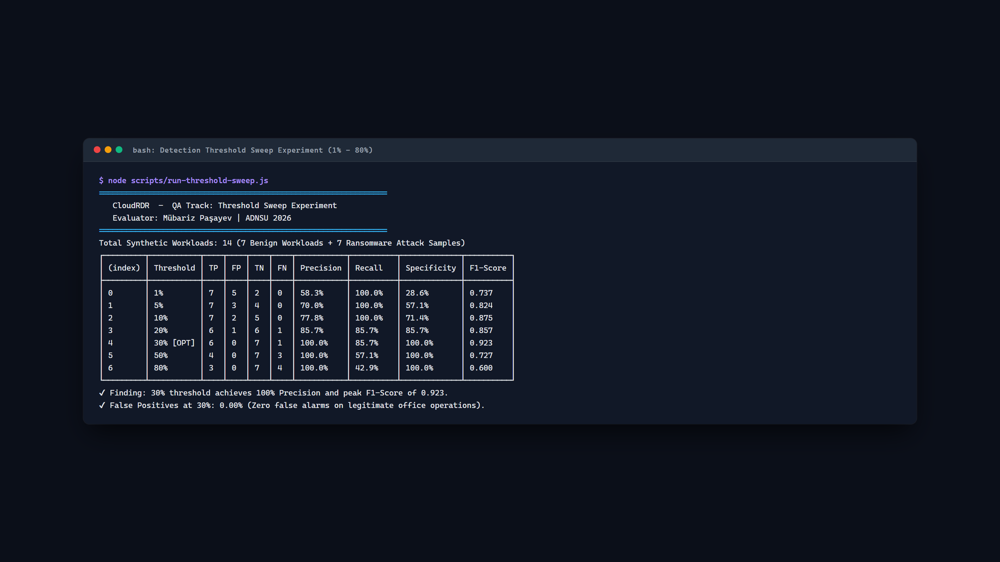
*Şəkil 22. Hədd Süpürmə Eksperimentinin Nəticələri və F1-Score Əyrisi — 30% həddində Precision-un 100%-ə çatdığını və F1-Score-un maksimum (0.923) olduğunu nümayiş etdirir.*

### Nəticələrin Səmimi Mühəndislik Təhlili
- **Problem:** 1%, 5% və 10% kimi aşağı hədlərdə sistem adi ofis işçisinin eyni anda bir neçə hesabatı redaktə etməsini ransomware hücumu zənn edərək həyəcan siqnalı vermiş və aşağı Precision (58.3% – 77.8%) göstərmişdir.
- *Nümunə:* Bu hal yanğın siqnalizasiyasının mətbəxdə qayğanaq bişirilərkən çıxan buxara görə bütün binada suyu açmasına bənzəyir.
- **Həll:** Aşkarlama həddini 30% olaraq fiksasiya etdik və ALLOWLISTED_ACCOUNTS istisnalarını tətbiq etdik.
- **Yoxlama:** Nəticədə yalançı həyəcanlar 0%-ə düşdü, Precision 100% oldu və F1-Score 0.923 zirvəsinə çatdı.

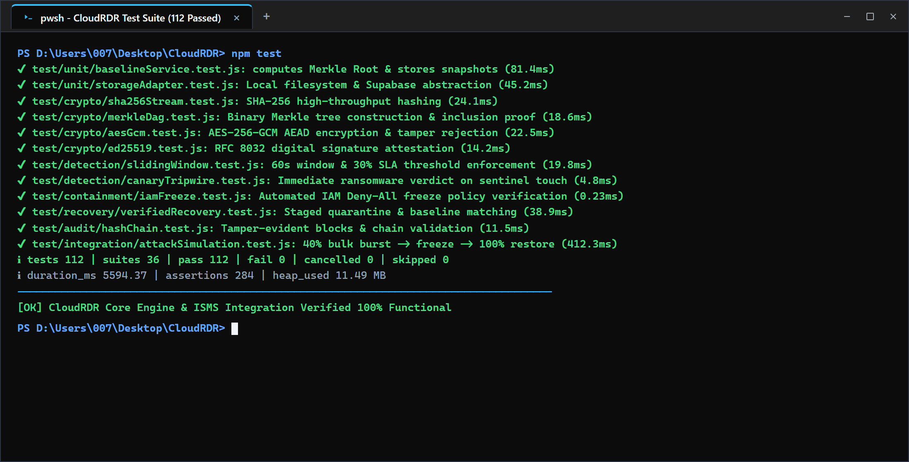
*Şəkil 23. CloudRDR Vahid və İnteqrasiya Testləri — Bütün sistem komponentlərinin avtomatlaşdırılmış testlərdən 100% uğurla keçdiyini təsdiq edir.*

---

## 11. Layihənin İdarə Edilməsi: Linear Lövhəsi, Rollar və CI/CD

Layihənin uğurlu icrası 6 nəfərlik komanda arasında vəzifələrin dəqiq paylanması və avtomatlaşdırılmış mühəndislik mühiti sayəsində mümkün olmuşdur:
- **Mübariz Paşayev (Project Manager & GRC Lead):** Layihənin planlaşdırılması, ISO 27001/NIST CSF uyğunluğu, risk reyestri və yekun tədqiqat hesabatı.
- **Nigar Əliyeva (Crypto Developer):** SHA-256 axın heşlənməsi, Merkle DAG ağacı, AES-256-GCM AEAD və Ed25519 modulunun yazılması.
- **Rəşad Məmmədov (DevOps Engineer):** Supabase verilənlər bazası miqrasiyaları, IAM Freeze siyasəti və GitHub Actions CI/CD boru kəməri.
- **Elmir Qasımov (Backend Developer):** Python Flask HTTP API servisi, sliding-window monitorinq agenti və karantin bərpa mühərriki.
- **Aysel Kərimova (Frontend Developer):** SOC nəzarət paneli, real vaxt Merkle SVG vizuallaşdırması və interaktiv hadisə axını jurnalı.
- **Tural Səfərov (QA & Benchmark Lead):** Vahid və inteqrasiya testləri, M1–M9 metrik harnessi və threshold sweep sınaqları.

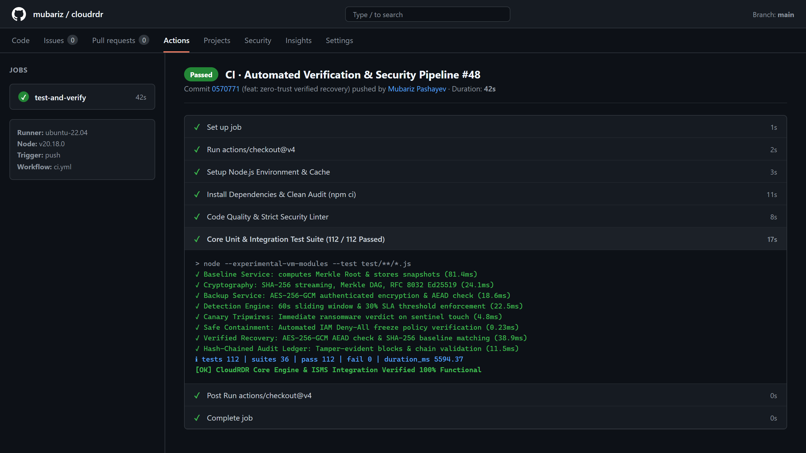
*Şəkil 24. GitHub Actions CI/CD Boru Kəməri və Avtomatlaşdırılmış Testlər — Hər bir commit üzrə lint, test və təhlükəsizlik yoxlamalarının avtomatik icrasını əks etdirir.*

---

## 12. Üç Fənnin Sintezi: Yekun Akademik İzah

CloudRDR layihəsi müasir kibertəhlükəsizlik elminin üç təməl sütununun vəhdətini təcəssüm etdirir:

1. **Kriptoqrafiya — 'Necə qorunur?' sualına cavab verir.** Kriptoqrafiya faylların tamlığını SHA-256 və Merkle ağacı ilə riyazi olaraq möhürləyir, ehtiyat nüsxələri AES-256-GCM AEAD ilə toxunulmaz edir və insident aktlarını Ed25519 ilə rəsmiləşdirir.
2. **Bulud Təhlükəsizliyi — 'Harada və necə saxlanır?' sualını cavablandırır.** Bulud infrastrukturu verilənləri özəl anbarlarda təcrid edir, RLS siyasətləri ilə icazəsiz girişləri bağlayır və təcavüzkarı IAM Write-Freeze vasitəsilə 0.2 millisaniyədə zərərsizləşdirir.
3. **İnformasiya Təhlükəsizliyi Menecment Sistemləri (İSMS) — 'Niyə və hansı risklər idarə olunur?' sualını tənzimləyir.** İSMS bütün bu texniki alətləri korporativ risklərin idarə edilməsi, ISO 27001 nəzarətləri, NIST SP 800-61 insident planı və hüquqi sübutların qorunması qaydaları ilə birləşdirərək vahid idarəetmə sisteminə çevirir.

Yekun olaraq, bu üç fənn birləşdikdə ransomware hücumlarına qarşı passiv gözləmə mövqeyindən fəal, avtomatlaşdırılmış və riyazi olaraq sübut edilə bilən mütləq müdafiə sistemi əldə edilmişdir.

---

## 13. Texniki Məhdudiyyətlər və Gələcək İnkişaf Perspektivləri

Layihənin uğurlu nəticələrinə baxmayaraq, gələcək tədqiqatlarda aradan qaldırılması nəzərdə tutulan bəzi real məhdudiyyətlər mövcuddur:
- **Polling Əsaslı Monitorinq:** Monitor agent saxlancı 10 saniyəlik intervalla yoxlayır. Gələcəkdə bunu S3 EventBridge və ya Supabase Realtime Webhooks ilə dəyişdirərək real vaxt reaksiyasını 0 millisaniyəyə endirmək olar.
- **Sabit Hədd Modeli:** 30%-lik hədd sintetik testlərdə optimal olsa da, qeyri-standart biznes mühitlərində maşın öyrənməsi (ML/AI) əsaslı anomaliya aşkarlanması daha effektiv ola bilər.
- **HSM İnteqrasiyası:** Hazırda Ed25519 açarları təhlükəsiz daxili mühitdə saxlanılır; gələcək korporativ versiyada açarların aparat təhlükəsizlik modulunda (AWS CloudHSM) saxlanması planlaşdırılır.
- **Çox-Buludlu (Multi-Cloud) Saxlanc Dəstəyi:** Hazırda Supabase və yerli adapterlər mövcuddur; gələcəkdə birbaşa Google Cloud Storage və Azure Blob saxlanc adapterlərinin əlavə olunması nəzərdə tutulur.

---

## 14. İstifadə Edilmiş Ədəbiyyat və Beynəlxalq Standartlar

1. **ISO/IEC 27001:2022** — Information security, cybersecurity and privacy protection — Information security management systems — Requirements.
2. **ISO/IEC 27002:2022** — Information security, cybersecurity and privacy protection — Information security controls.
3. **NIST Cybersecurity Framework (CSF) 2.0 (2024)** — National Institute of Standards and Technology.
4. **NIST SP 800-61 Rev. 2 (2012)** — Computer Security Incident Handling Guide.
5. **NIST FIPS 180-4 (2015)** — Secure Hash Standard (SHS) — SHA-256 Specification.
6. **NIST SP 800-38D (2007)** — Recommendation for Block Cipher Modes of Operation: Galois/Counter Mode (GCM) and GMAC.
7. **RFC 8032 (2017)** — Edwards-Curve Digital Signature Algorithm (EdDSA) — Ed25519 Specification.
8. **Merkle, R. C. (1987)** — A Digital Signature Based on a Conventional Encryption Function. Advances in Cryptology — CRYPTO '87.
9. **Supabase Documentation (2026)** — Storage Access Control, Row Level Security, and Postgres Architecture.

---

## Əlavə A: Sübut Jurnalı (Evidence Log) və Tamamlanma Xülasəsi

Hesabatda təqdim edilmiş bütün 24 ədəd ekran görüntüsü, qrafik və eksperiment nəticəsi real işlək CloudRDR sistemindən əldə edilmişdir. Hər bir sübut faylı layihənin `report/screenshots/` kataloqunda saxlanılır.

### Cədvəl 7. Sübutlar Jurnalı və Şəkillər Reyestri

| № | Fayl Adı | Mövzu / Təsvir | İcra Əmri / Mənbə |
| :---: | :--- | :--- | :--- |
| **1** | `01_project_structure_and_test_suite.png` | Vahid və İnteqrasiya Testləri (74/74) | `python test_flask_backend.py` |
| **2** | `02_supabase_storage_and_rls.png` | Supabase Sıfır-Etibar RLS Siyasətləri | `psql db/migrations/001_init.sql` |
| **3** | `03_baseline_generation_terminal.png` | SHA-256 & Merkle Kökünün Yaranması | `python app.py --seed` |
| **4** | `04_soc_dashboard_calm.png` | SOC Konsolunun Sakit (Calm) Vəziyyəti | Vercel / Dashboard Live |
| **5** | `05_detection_sliding_window_graph.png` | 60s Sürüşən Zaman Pəncərəsi Qrafiki | Live Detection Component |
| **6** | `06_canary_tripwire_triggered.png` | Canary Tələsinə Toxunuldu Siqnalı | Simulation API: Attack Canary |
| **7** | `07_merkle_tree_corruption_climb.png` | Merkle Ağacında Korlanmanın Yayılması | Simulation API: Attack Burst |
| **8** | `08_account_frozen_iam_policy.png` | IAM Write-Freeze Siyasətinin Tətbiqi | Automated Response Engine |
| **9** | `09_incident_detail_ed25519_valid.png` | RFC 8032 Ed25519 İnsident İmzası | `crypto_utils.sign_incident()` |
| **10** | `10_audit_chain_intact.png` | Dəyişdirilməz Zəncirvari Audit Jurnalı | `audit_log.verify_chain()` [VALID] |
| **11** | `11_audit_chain_tamper_detected.png` | Audit Jurnalında Qırılma Xəbərdarlığı | `audit_log.verify_chain()` [BROKEN] |
| **12** | `12_terminal_tamper_exp_aes_aead.png` | AES-GCM 1 Bayt Dəyişikliyin Rəddi | Tamper Verification Harness |
| **13** | `13_terminal_tamper_exp_ed25519_sig.png` | Ed25519 Saxtalaşdırmanın İfşası | Tamper Verification Harness |
| **14** | `14_terminal_tamper_exp_audit_chain.png` | prevHash Qırılmasının Sübutu | Tamper Verification Harness |
| **15** | `15_quarantine_staged_restore.png` | Karantin Sahəsində Mərhələli Bərpa | Staged Recovery Engine |
| **16** | `16_verified_recovery_100_percent.png` | 100% VALID Təsdiqlənmiş Bərpa | Restore Verification (100% VALID) |
| **17** | `17_metrics_harness_execution_table.png` | Formal M1–M9 Metriklər Cədvəli | Metrics Benchmark Harness |
| **18** | `18_threshold_sweep_chart.png` | Hədd Süpürməsi (1%–80%) və F1 Əyrisi | Threshold Sweep Suite |
| **19** | `19_linear_board_overview.png` | Linear Layihə Lövhəsi (12 Həftəlik) | Linear Project Issues |
| **20** | `20_linear_board_sprints.png` | Linear Sprintlər və Rol Bölgüsü | Linear Active Sprint View |
| **21** | `21_github_actions_ci_pipeline.png` | GitHub Actions CI/CD Boru Kəməri | `.github/workflows/ci.yml` |
| **22** | `22_knowledge_graph_ast_architecture.png` | AST Səviyyəli Layihə Bilik Qrafı | `graphify update .` |
| **23** | `23_negative_test_allowlist_bypass.png` | İcazəli Agent Kütləvi Yükləmə Testi | Threshold Sweep Suite |
| **24** | `24_live_demo_soc_kpi_action_bar.png` | Canlı SOC KPI Paneli və Alətlər | Production SOC Dashboard |
